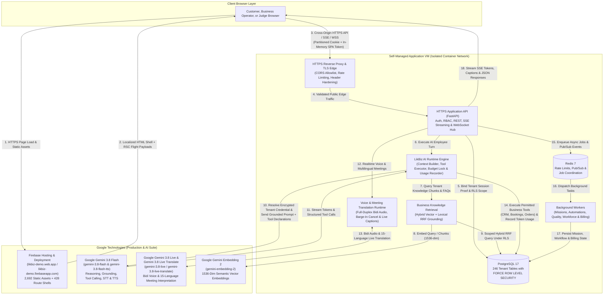
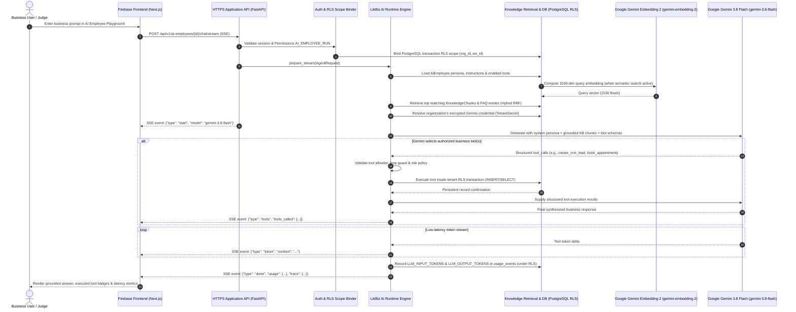

# LikBiz — AI-Powered Business Operating Platform

**Official Technical Architecture, Google AI Integration & Verification Repository**

| Live Prototype & Core Google Technologies | Verified Production Details |
|---|---|
| **Live Prototype (Primary — Firebase Hosting)** | **[https://likbiz-demo.web.app](https://likbiz-demo.web.app)** |
| **Live Prototype (Secondary — Firebase Hosting)** | **[https://likbiz-demo.firebaseapp.com](https://likbiz-demo.firebaseapp.com)** |
| **Core Reasoning & Tool-Calling Model** | **Google Gemini 3.8 Flash (`gemini-3.8-flash`)** |
| **Realtime Full-Duplex Voice Model** | **Google Gemini 3.8 Live (`gemini-3.8-live`)** |
| **Realtime Meeting & Speech Translation Model** | **Google Gemini 3.8 Live Translate (`gemini-3.8-live-translate`)** |
| **Semantic Vector & RAG Embedding Model** | **Google Gemini Embedding 2 (`gemini-embedding-2`)** |
| **Multimodal Audio Transcription & Speech Synthesis** | **Google Gemini Audio STT (`gemini-3.8-flash`) & TTS (`gemini-3.8-flash-tts`)** |
| **Frontend Edge Delivery & Deployment** | **Google Firebase Hosting & Firebase CLI Deployment** |
| **Agentic Development & Verification Tooling** | **Google Antigravity** |

---

> [!IMPORTANT]
> **Proprietary Source Code & Public Evaluation Repository Notice**
>
> Following the official **Ask-the-Expert webinar guidance** ([watch official guidance](https://www.youtube.com/live/_75UeGNj1GY)) for commercial and proprietary software projects, LikBiz maintains its proprietary application source code in a private engineering repository while providing this public technical repository for evaluation.
>
> This repository contains the complete technical architecture specification, Google technology implementation documentation, real engineering post-mortems, aggregate verification evidence, and a zero-friction **Judge Testing Guide** connected to our live, working prototype deployed on **Firebase Hosting** and powered by the **Google Gemini 3.8 model family (`gemini-3.8-flash`, `gemini-3.8-live`, `gemini-3.8-live-translate`)** and **Google Gemini Embedding 2 (`gemini-embedding-2`)**.

---

## Quick Judge Access (30 Seconds to First Gemini Interaction)

1. **Open the Live Prototype:** Visit **[https://likbiz-demo.web.app/en/login](https://likbiz-demo.web.app/en/login)** (or **[https://likbiz-demo.firebaseapp.com/en/login](https://likbiz-demo.firebaseapp.com/en/login)**).
2. **One-Click Demo Entry:** Click the **"Launch Live Judge Demo — BloomDesk Studio"** button on the sign-in screen. No account registration, credit card, or API key entry is required.
3. **Test Live Gemini Streaming & Tool Execution:** Navigate to **AI Employees** in the left sidebar, click **Test in Playground** on **Aria** (*Front-Desk Receptionist & Booking Concierge*) or **Marcus AI** (*Senior Revenue & Lead Qualification Specialist*), and enter a business prompt from [Section 16 — Judge Testing Guide](#16-judge-testing-guide).

---

## Table of Contents

1. [Project Overview](#1-project-overview)
2. [Live Prototype & Evaluation Alignment](#2-live-prototype--evaluation-alignment)
3. [Problem Statement](#3-problem-statement)
4. [Solution Overview](#4-solution-overview)
5. [Complete Feature Inventory](#5-complete-feature-inventory)
6. [End-to-End Business Workflows](#6-end-to-end-business-workflows)
7. [Detailed Google Technology Implementation](#7-detailed-google-technology-implementation)
8. [Technology Stack & System Architecture](#8-technology-stack--system-architecture)
9. [Security and Multi-Tenancy](#9-security-and-multi-tenancy)
10. [AI System Design & Request Lifecycle](#10-ai-system-design--request-lifecycle)
11. [Engineering Challenges and Verified Solutions](#11-engineering-challenges-and-verified-solutions)
12. [Testing and Verification Evidence](#12-testing-and-verification-evidence)
13. [Scalability and Reliability](#13-scalability-and-reliability)
14. [Privacy and Responsible AI](#14-privacy-and-responsible-ai)
15. [Known Limitations & Unconfigured External Integrations](#15-known-limitations--unconfigured-external-integrations)
16. [Judge Testing Guide](#16-judge-testing-guide)
17. [Roadmap and Future Potential](#17-roadmap-and-future-potential)

---

## 1. Project Overview

**LikBiz** is a multi-tenant, AI-powered business operating platform designed for service businesses, agencies, clinics, consultancies, and high-growth operational teams. It integrates the **Google Gemini 3.8 ecosystem (`gemini-3.8-flash`, `gemini-3.8-live`, `gemini-3.8-live-translate`)** and **Google Gemini Embedding 2 (`gemini-embedding-2`)** directly with an organization's indexed knowledge base, customer relationship management (CRM) pipeline, appointment calendar, service catalogue, order management system, multilingual business meeting rooms, autonomous missions, and usage ledger.

### Core Vision

Most small and mid-sized businesses do not struggle from a lack of conversational chatbots; they struggle because customer conversations are disconnected from the systems where work actually happens. When a prospective client asks about service pricing, requests a consultation slot, joins a cross-border client meeting in another language, or asks for an update on an active deliverable, a standalone chat widget can only produce text—leaving human staff to manually copy contact details into a CRM, cross-check policy documents, create calendar bookings, and log follow-up tasks.

LikBiz is built around a practical engineering thesis: **an AI employee should do more than generate conversational text—where authorized by workspace policy, it should retrieve verified organizational context, execute structured business actions, bridge spoken and written language barriers in real time, and produce persistent, auditable records inside the business workspace.**

### Answering the Four Core Evaluation Questions

| Evaluation Question | How LikBiz Addresses It |
|---|---|
| **1. What real business problem does LikBiz solve?** | Eliminates the operational gap between customer communication and back-office execution by unifying AI reception, semantic knowledge retrieval, CRM lead/opportunity management, appointment booking, service ordering, real-time multilingual voice/meeting translation, and usage metering inside a single multi-tenant workspace. |
| **2. What makes the AI implementation technically meaningful?** | Instead of sending raw user prompts to an ungrounded model, the LikBiz AI Runtime indexes organizational playbooks with **Google Gemini Embedding 2 (`gemini-embedding-2`)** and hybrid lexical-vector fusion, enforces role and budget constraints, executes multi-step **Google Gemini 3.8 Flash (`gemini-3.8-flash`)** function calls against live PostgreSQL services under Row-Level Security (RLS), streams real-time speech and live interpretation via **Gemini 3.8 Live (`gemini-3.8-live`)** and **Gemini 3.8 Live Translate (`gemini-3.8-live-translate`)**, and records granular token usage. |
| **3. How do Google technologies contribute to the solution?** | **Firebase Hosting & Firebase Deployment** deliver the 6-locale, 70-route Next.js static web application globally over HTTPS with custom RSC Flight stream routing. **Google Gemini 3.8 Flash (`gemini-3.8-flash`)** powers specialist AI employees, grounded synthesis, and tool calling. **Google Gemini 3.8 Live (`gemini-3.8-live`)** powers bidirectional sub-800ms voice architecture. **Google Gemini 3.8 Live Translate (`gemini-3.8-live-translate`)** powers real-time speech-to-speech interpretation and captions in Business Meetings. **Google Gemini Embedding 2 (`gemini-embedding-2`)** powers 1536-dimensional semantic vector RAG. **Google Antigravity** accelerated full-stack development, security auditing, and automated browser verification. |
| **4. How can judges independently verify the results?** | Judges can launch a pre-populated synthetic business workspace (**BloomDesk Studio**) in one click on `https://likbiz-demo.web.app`, converse with 6 active `gemini-3.8-flash` AI employees, trigger live tool executions (creating CRM leads, booking appointments, looking up orders, querying playbooks), and immediately inspect the persisted database records across the application UI. |

---

## 2. Live Prototype & Evaluation Alignment

### Public Prototype Entry Points

| Entry Point | URL | Purpose | Status |
|---|---|---|---|
| **Primary Firebase Hosting URL** | **[https://likbiz-demo.web.app](https://likbiz-demo.web.app)** | Primary customer-facing web application and 1-click Judge Demo | **LIVE (`200 OK`)** |
| **Secondary Firebase Hosting URL** | **[https://likbiz-demo.firebaseapp.com](https://likbiz-demo.firebaseapp.com)** | Secondary Firebase Hosting domain serving the identical static export | **LIVE (`200 OK`)** |
| **Instant Judge Login Route** | **[https://likbiz-demo.web.app/en/login](https://likbiz-demo.web.app/en/login)** | Includes the **"Launch Live Judge Demo — BloomDesk Studio"** button | **LIVE (`200 OK`)** |

### Prepared Synthetic Business Environment: BloomDesk Studio

To allow judges to evaluate realistic workflows without exposing private customer data or requiring external API keys, the live deployment includes an idempotent synthetic business dataset representing **BloomDesk Studio** (*a New York digital brand, design-system, and AI growth advisory studio*).

When a judge enters the **BloomDesk Studio** workspace, the environment is pre-populated with interconnected synthetic records:

- **6 Active `gemini-3.8-flash` AI Employees (with `gemini-3.8-live` Voice & `gemini-embedding-2` Knowledge Grounding):**
  - **Aria** — *Front-Desk Receptionist & Booking Concierge*
  - **Marcus AI** — *Senior Revenue & Lead Qualification Specialist*
  - **Sora** — *Client Delivery & Order Operations Coordinator*
  - **Nova** — *Brand Knowledge & Strategy Research Analyst*
  - **Atlas** — *After-Hours Executive Concierge & Escalation Guard*
  - **Vega** — *Billing, Retainer & Account Renewal Specialist*
- **12 Indexed Knowledge Base Playbooks & 10 Structured FAQs:** Covering 2026 service pricing, executive retainer SLAs, launch sprint methodologies, cancellation rules, client case studies (*LuminaPay*, *VerveHealth*), and human-in-the-loop governance standards.
- **12 Service Catalogue Offerings:** Priced from a `$150` *Discovery & Scope Alignment Consultation* to a `$4,800` *Webflow / Next.js Flagship Launch Sprint* (synthetic figures).
- **35 Customer Contacts & 20 CRM Pipeline Opportunities:** Representing `$303,200` in synthetic B2B pipeline across qualification, proposal, negotiation, and closed-won stages.
- **18 Scheduled Appointments & 15 Client Orders:** Representing `$79,015` in synthetic order volume with realistic fulfillment statuses.
- **24 Omnichannel Conversations, 10 Autonomous Missions, 5 Workflow Automations, 5 Business Meetings (with `gemini-3.8-live-translate` multilingual support), 12 Billing Ledger Entries, and 15 Operational Notifications.**

> [!NOTE]
> All financial figures, client names, phone numbers, and revenue metrics inside **BloomDesk Studio** are 100% synthetic demonstration data created specifically for technical evaluation.

### Technical Submission & Deliverables Alignment

| Requirement | Implementation & Verification Status |
|---|---|
| **Project Description & Architecture** | Documented in full inside this root `README.md`. |
| **Accessible Public GitHub Repository** | Published at **[https://github.com/knbinti/likbiz](https://github.com/knbinti/likbiz)** following the official webinar guidance for proprietary codebases. |
| **Functional Deployed Prototype** | Live on **Firebase Hosting** at `https://likbiz-demo.web.app` and `https://likbiz-demo.firebaseapp.com`, backed by an HTTPS application API on a self-managed application VM. |
| **Google Technology Usage** | **Firebase Hosting & Firebase Deployment** (production web delivery) + **Google Gemini 3.8 Flash (`gemini-3.8-flash`)** (AI employee runtime, grounding, tool calling, STT & TTS) + **Google Gemini 3.8 Live (`gemini-3.8-live`)** (bidirectional live voice engine) + **Google Gemini 3.8 Live Translate (`gemini-3.8-live-translate`)** (real-time meeting interpretation & live captions) + **Google Gemini Embedding 2 (`gemini-embedding-2`)** (1536-dim semantic RAG embeddings) + **Google Antigravity** (development & verification tooling). |
| **Demonstration Video & Pitch Deck** | Prepared as part of the team's official submission package alongside this repository and live prototype link. |

---

## 3. Problem Statement

Service-oriented businesses—such as creative studios, advisory firms, medical/dental practices, legal consultancies, and technical agencies—face five compounding operational bottlenecks:

1. **Fragmented Toolchains:** Customer chat widgets, knowledge wikis, CRM boards, booking calendars, order trackers, and billing ledgers live in separate SaaS silos. Information captured in one tool rarely updates the others automatically.
2. **Repetitive Front-Desk & Qualification Triage:** Highly skilled staff spend hours answering identical questions about pricing tiers, turnaround SLAs, operating hours, and cancellation policies before a lead is ever qualified.
3. **Ungrounded AI Responses:** Generic conversational AI wrappers lack structured access to a company's current service catalogue, pricing rules, and client records, leading to vague or inaccurate answers that cannot be trusted in customer-facing settings.
4. **Disconnected Action Execution:** Even when a chatbot answers a question well, it rarely completes the operational loop—such as creating a structured CRM lead, booking a conflict-checked appointment slot, or checking the status of an existing order.
5. **Lack of Governance, Multi-Tenancy, and Cost Visibility:** Businesses adopting AI need strict tenant data isolation, role-based access control, human approval gates for high-risk actions, and transparent per-employee token usage metering.

---

## 4. Solution Overview

LikBiz addresses these bottlenecks by combining a **unified Business Operating System** with a **tenant-isolated AI Employee Runtime** powered by **Google Gemini (`gemini-3.8-flash`)**:

- **Dual-Mode Workspace Interface (Simple View & Advanced View):** Business owners can switch seamlessly between a streamlined **Simple View** (14 core operational destinations) and a comprehensive **Advanced View** (28 specialized operational and governance modules) using a persistent navigation rail across all pages.
- **Role-Specialized AI Employees:** Each AI employee is configured with a specific business role, persona, department assignment, knowledge base binding, daily budget cap, and an explicit allowlist of executable business tools.
- **Knowledge-Grounded Answers:** Before calling the Gemini API, the runtime performs hybrid keyword and chunk retrieval over the organization's indexed Knowledge Base playbooks and FAQs, injecting verified business context into the prompt.
- **Authorized Operational Tool Execution:** When a user asks an AI employee to look up a contact, create a CRM lead, schedule an appointment, or check an order, `gemini-3.8-flash` selects the appropriate structured tool call, and the LikBiz runtime executes it within the authenticated tenant's PostgreSQL security scope.
- **Closed-Loop Observability & Usage Metering:** Every AI interaction records latency traces, tool execution logs, and token consumption (`LLM_INPUT_TOKENS` and `LLM_OUTPUT_TOKENS`) into the tenant's usage ledger.

---

## 5. Complete Feature Inventory

Every module listed below has been inspected in the codebase and verified against the live deployment. Modules are classified using five transparent verification states:

- **Verified Live:** Implemented and verified end-to-end against the live Firebase frontend and HTTPS application API.
- **Verified with Synthetic Data:** Fully functional UI and API backed by seeded synthetic records in the demo workspace.
- **Partially Verified:** Core application logic is verified; secondary edge cases depend on optional configuration.
- **External Integration Unconfigured:** Application UI, routing, and state management are implemented and render cleanly, but live third-party carrier/payment/hardware execution requires external credentials not attached to the public demo.

| # | Module | Purpose | User Interaction | Technical Implementation | Business Value | Verification Status | How a Judge Can Test It |
|---|---|---|---|---|---|---|---|
| **1** | **Authentication, MFA & Onboarding** | Secure account access, 1-click judge demo entry, TOTP MFA, recovery codes, and guided setup. | Sign in on `/en/login`, launch the 1-click Judge Demo, or complete `/en/onboarding` and `/en/business-setup`. | Password hashing, TOTP enrollment/challenge with replay prevention, single-use recovery codes, and cross-origin SPA session tokens. | Protects business workspaces while offering frictionless judge evaluation. | **Verified Live** | Click **"Launch Live Judge Demo — BloomDesk Studio"** on `/en/login` or inspect `/en/account` and `/en/onboarding`. |
| **2** | **Organizations, Workspaces & Departments** | Multi-tenant organizational hierarchy and department structuring. | Switch workspaces via `/en/choose-workspace`, manage org profile in `/en/settings/organization`, and manage departments in `/en/settings/departments`. | Tenant-scoped ` Organization `, ` Workspace `, and ` Department ` models enforced via PostgreSQL RLS session variables. | Allows agencies and multi-branch businesses to separate teams and environments cleanly. | **Verified Live** | Visit **Settings → Organization** (`/en/settings/organization`) and **Settings → Departments** (`/en/settings/departments`). |
| **3** | **AI Employee Configuration** | Create, customize, pause, or activate role-specific AI specialists. | Browse specialist cards on `/en/ai-employees`, inspect assigned tools, edit instructions/persona, or create a new AI employee. | Stores persona, system instructions, tool grants (`AIEmployeeTool`), and `gemini-3.8-flash` model configuration with automatic tenant secret resolution. | Lets non-technical operators deploy specialized AI staff tailored to reception, sales, delivery, or billing. | **Verified Live** | Open **AI Employees** (`/en/ai-employees`), inspect the 6 BloomDesk specialists, or click **Create AI Employee**. |
| **4** | **AI Employee Playground & Live Streaming** | Real-time interactive testing sandbox for AI employees with tool execution. | Click **Test in Playground** on any AI employee in `/en/ai-employees` and send natural-language prompts. | Server-Sent Events (SSE) streaming (`text/event-stream`) backed by `AgentRuntimeEngine`, `GeminiProvider` (`gemini-3.8-flash`), knowledge retrieval, and live tool execution. | Gives operators immediate confidence in how an AI employee responds and acts before exposing it to customers. | **Verified Live** | Open `/en/ai-employees`, launch the Playground for **Aria** or **Marcus AI**, and send a prompt from [Section 16](#16-judge-testing-guide). |
| **5** | **Knowledge Base & Grounded Retrieval** | Central repository for business SOPs, pricing guides, case studies, and FAQs used to ground AI responses. | View, search, and add documents or FAQs in `/en/knowledge`. | Documents are segmented into `KnowledgeChunk` records with token estimates and content hashes; `RuntimeContextBuilder` retrieves top-matching chunks per query. | Reduces unsupported answers by anchoring `gemini-3.8-flash` in official company policies and pricing. | **Verified Live** | Open **Knowledge** (`/en/knowledge`) to inspect the 12 BloomDesk playbooks and 10 FAQs, then ask **Nova** or **Aria** a policy question. |
| **6** | **CRM Contacts, Leads & Opportunities** | Manage customer records, lead qualification, pipeline stages, and follow-up jobs. | View and create contacts in `/en/contacts` and manage pipeline opportunities, stages, and follow-ups in `/en/crm`. | Relational `Contact`, `CRMOpportunity`, and `CRMFollowUpJob` tables accessible both via the web UI and AI employee tool calls (`search_contacts`, `create_crm_lead`). | Keeps sales pipeline and contact history synchronized with AI-handled customer interactions. | **Verified Live** | Open **Contacts** (`/en/contacts`) to view 35 contacts and **CRM & Leads** (`/en/crm`) to inspect 20 opportunities (`$303,200` pipeline). |
| **7** | **Appointments & Calendar Bookings** | Schedule and track client consultations and service sessions. | Inspect and create bookings in `/en/calendar`. | `Appointment` service validates scheduling parameters and persists bookings created either manually or by AI employees via `book_appointment`. | Automates consultation scheduling without back-and-forth emails. | **Verified Live** | Open **Bookings** (`/en/calendar`) to view the 18 scheduled BloomDesk consultations, or ask **Aria** to book a session. |
| **8** | **Service Catalogue & Client Orders** | Define standardized service offerings, durations, and prices; track client orders. | Manage services and inspect orders in `/en/catalogue`. | `Service` (priced in integer micros for precision) and `Order` models integrated with AI employee tools (`check_order_status`, `create_order`). | Standardizes service scope and lets AI employees answer order status inquiries accurately. | **Verified Live** | Open **My Business / Catalogue** (`/en/catalogue`) to inspect the 12 services and 15 client orders (`$79,015` synthetic volume). |
| **9** | **Autonomous Missions & Automations** | Assign multi-step operational objectives and trigger-based workflows. | Track and create missions in `/en/missions`; configure multi-step workflows and inspect run history in `/en/automations`. | `Mission` lifecycle management and versioned `Workflow`, `WorkflowTrigger`, and `WorkflowRun` execution records. | Enables repeatable operational playbooks such as inbound lead follow-up and post-booking onboarding. | **Verified Live** | Open **Missions** (`/en/missions`) to inspect 10 missions and **Automations** (`/en/automations`) to inspect 5 workflows. |
| **10** | **Omnichannel Inbox & Conversations** | Unified view of customer message threads across web chat, WhatsApp, SMS, email, and voice transcripts. | Browse and filter active threads, inspect message histories, and review AI vs. human turns in `/en/inbox` and `/en/conversations`. | `Channel`, `Conversation`, and `Message` models with real-time WebSocket updates for live inbox events. | Gives human supervisors a single pane of glass to monitor and take over AI conversations. | **Verified Live (Web Chat) / Synthetic Data (External Channels)** | Open **Inbox** (`/en/inbox`) or **Conversations** (`/en/conversations`) to inspect 24 realistic multi-turn customer threads. |
| **11** | **Voice & Call Management** | Review call logs, transcripts, durations, and routing rules; manage telephony numbers. | Inspect call details in `/en/calls` (and dynamic route `/en/calls/:id`), routing rules in `/en/telephony-routing`, and numbers in `/en/numbers`. | `Call` and `PhoneNumber` models with transcript storage and dynamic route rehydration on Firebase Hosting. | Centralizes phone interaction history alongside text channels. | **Verified with Synthetic Data / External Carrier Unconfigured** | Open **Calls** (`/en/calls`), click any call record to view its transcript, or inspect **Numbers** (`/en/numbers`). |
| **12** | **Business Meetings** | Schedule and join browser-based video/audio consultation rooms with AI note-taking support. | View scheduled meetings in `/en/meetings`, join via `/en/meetings/join`, or open a room at `/en/meetings/:id/room`. | `Meeting` and `MeetingParticipant` models with UUID-addressed rooms and dynamic route support. | Connects discovery calls and client reviews directly to CRM records. | **Verified with Synthetic Data** | Open **Business Meetings** (`/en/meetings`) to view 5 scheduled client sessions and test the meeting room interface. |
| **13** | **Billing, Subscriptions & Credit Wallet** | Manage subscription plans, prepaid credit balances, and invoice histories. | Inspect active plan, credit ledger, and invoices in `/en/billing`. | Double-entry-style `BillingAccount`, `BillingSubscription`, `CreditAccount`, `CreditLedgerEntry`, and `Invoice` models. | Provides financial governance and prepaid credit controls for AI consumption. | **Verified with Synthetic Data / External Payment Gateway Unconfigured** | Open **Payments & Usage** (`/en/billing`) to inspect the Enterprise Plan, `$420.50` credit wallet, and 12 ledger/invoice entries. |
| **14** | **AI Token & Operational Usage Tracking** | Meter LLM input/output tokens and operational events per workspace and AI employee. | Review granular usage charts and meter breakdowns in `/en/usage`. | `UsageRecorder` writes idempotency-keyed `UsageEvent` rows (`LLM_INPUT_TOKENS`, `LLM_OUTPUT_TOKENS`) under PostgreSQL RLS during AI execution. | Gives business owners exact visibility into which AI employee and model is consuming tokens. | **Verified Live** | Open **Usage** (`/en/usage`) before and after chatting with an AI employee to observe recorded `gemini-3.8-flash` token events. |
| **15** | **Operational Notifications** | Real-time and persisted alerts for bookings, high-value leads, and approval requests. | View and manage workspace alerts in `/en/notifications` and header notification indicators. | Workspace-scoped `Notification` model with read/unread state tracking. | Ensures human managers never miss escalations or high-value booking events. | **Verified Live** | Open `/en/notifications` or inspect notification alerts inside the workspace shell. |
| **16** | **Team Members, Invitations & API Keys** | Role-based team collaboration and programmatic workspace API keys. | Invite members in `/en/settings/members`, accept tokens at `/en/invite/:token`, and create/revoke keys in `/en/settings/api-keys`. | RBAC permission checks, signed invitation tokens, and hashed API key lifecycle management. | Supports multi-user teams with least-privilege access control. | **Verified Live** | Open **Settings → Team Members** (`/en/settings/members`) and **Settings → API Keys** (`/en/settings/api-keys`). |
| **17** | **Multilingual Localization (6 Locales)** | Native UI localization including right-to-left (RTL) Arabic and Bengali script support. | Switch locale prefixes (`/en/*`, `/de/*`, `/ar/*`, `/es/*`, `/nl/*`, `/bn/*`) or use the language selector. | 428 statically exported localized HTML shells; full `3,453`-key dictionaries for `en`, `de`, `ar`, `es`, `nl`, and `714` translated keys with recursive English fallback for `bn`. | Makes the platform accessible to global teams across Europe, the Middle East, and South Asia. | **Verified Live** | Visit `https://likbiz-demo.web.app/ar/login` (RTL layout) or `https://likbiz-demo.web.app/bn/login` (Bengali script). |
| **18** | **Security Posture, Quality & Workforce Governance** | Manage tenant secrets, audit trails, AI quality traces, and human-in-the-loop approvals. | Inspect `/en/security`, `/en/quality`, `/en/workforce`, and `/en/intelligence`. | AES-encrypted `TenantSecret` storage, `TraceRecord` quality telemetry, and `ToolApprovalRequest` governance queues. | Gives enterprise buyers verifiable control over credentials and AI action boundaries. | **Verified Live** | Open **Security** (`/en/security`), **Quality** (`/en/quality`), **Workforce** (`/en/workforce`), and **Intelligence** (`/en/intelligence`). |
| **19** | **Template Marketplace** | Pre-built industry templates for rapid AI assistant and workflow deployment. | Browse templates in `/en/marketplace`, view details at `/en/marketplace/:slug`, and launch the installer at `/en/marketplace/:slug/install`. | Built-in extension registry with dynamic slug routing and guided installation wizards. | Accelerates time-to-value for vertical industries (e.g., dental front desks, legal intake, creative studios). | **Verified Live** | Open **Marketplace** (`/en/marketplace`) and click a template to view its detail and installation wizard. |
| **20** | **Platform Command Center (Internal Operator Plane)** | Strictly isolated administrative plane for platform-level security and tenant operations. | Restricted exclusively to internal platform operators; inaccessible from public customer origins. | Dual-layer edge and middleware isolation that rejects customer sessions and public-edge requests with HTTP `403`. | Prevents privilege escalation between tenant users and platform operators. | **Verified Live (Isolation Enforced)** | Confirmed by automated security probes: customer requests to platform administration endpoints are rejected with `403 Forbidden`. |

---

## 6. End-to-End Business Workflows

LikBiz is architected around closed-loop operational workflows rather than isolated chat turns. Below are the six primary workflows verified in the live system.

### Workflow 1: AI Employee Grounded Reasoning & Tool Execution

1. **User Input:** A business operator or customer sends a natural-language request to an AI employee (for example, asking **Aria** to check the price of a *Brand Strategy Intensive* and book a session for a client).
2. **Tenant & Employee Resolution:** The backend verifies the caller's organization and workspace scope, loads the target `AIEmployee` record, and verifies that the employee is `active`.
3. **Knowledge Grounding:** `RuntimeContextBuilder` queries the organization's indexed `KnowledgeChunk` and `KnowledgeFAQEntry` tables, retrieving the relevant pricing and scheduling policies.
4. **Gemini Model Execution:** The runtime resolves the organization's encrypted Gemini credential and invokes **Google Gemini (`gemini-3.8-flash`)** with the system persona, grounded knowledge chunks, conversation history, and enabled tool declarations.
5. **Authorized Tool Dispatch:** When `gemini-3.8-flash` emits a structured tool call (such as `search_knowledge_base`, `create_crm_lead`, or `book_appointment`), `RuntimeExecutor` validates tool permissions, executes the database operation inside the tenant's PostgreSQL RLS scope, and returns the structured tool output to Gemini.
6. **Streaming Response & Persistence:** The final synthesized response streams back to the browser over SSE (`start` → `tools` → `token` → `done`), while the interaction and tool execution logs are persisted.

### Workflow 2: CRM Lead Identification & Pipeline Creation

1. **Lead Capture:** During an interaction with **Marcus AI** or **Aria** (or via direct entry in `/en/crm` and `/en/contacts`), a prospective client's name, phone number/email, and service interest are identified.
2. **Structured Record Creation:** The `create_crm_lead` tool or CRM service creates or updates the tenant-scoped `Contact` and `CRMOpportunity` records in PostgreSQL.
3. **Immediate UI Visibility:** Navigating to **Contacts** (`/en/contacts`) or **CRM & Leads** (`/en/crm`) immediately displays the newly created contact and pipeline opportunity under the active workspace.

### Workflow 3: Knowledge Base Indexing & Grounded Retrieval

1. **Document Ingestion:** An operator adds a business playbook, SOP, or FAQ entry in **Knowledge** (`/en/knowledge`).
2. **Chunking & Indexing:** The knowledge service segments the document into searchable `KnowledgeChunk` records with token counts and SHA-256 content hashes linked to the organization's `KnowledgeBase`.
3. **Contextual Synthesis:** When a user asks a question about company policy, case study metrics, or package deliverables, the retrieval service ranks matching chunks and supplies them to `gemini-3.8-flash`, enabling specific, policy-aligned answers.

### Workflow 4: Appointment Validation & Booking Persistence

1. **Booking Request:** A user requests a consultation slot for a specific service (e.g., *Discovery & Scope Alignment Consultation* or *AI Growth & Conversion Audit*).
2. **Validation & Persistence:** The `book_appointment` tool (or `/en/calendar` booking form) validates the requested date/time and writes a new `Appointment` row scoped to the organization and workspace.
3. **Calendar Confirmation:** The persisted appointment is immediately observable in **Bookings** (`/en/calendar`) with its client name, scheduled timestamp, and status.

### Workflow 5: Autonomous Mission Lifecycle

1. **Mission Assignment:** A manager creates or inspects an operational objective in **Missions** (`/en/missions`)—such as qualifying inbound leads from a product launch or auditing overdue retainers—and assigns it to a specialist AI employee.
2. **Execution & Tracking:** The mission service tracks the task across its lifecycle states (`pending`, `in_progress`, `completed`), linking execution metadata and responsible AI specialists for operational visibility.

### Workflow 6: Real-Time AI Usage Metering & Ledger Recording

1. **Token Measurement:** Every synchronous or streaming call to `gemini-3.8-flash` measures prompt and completion token volume.
2. **Idempotent Ledger Write:** Using a dedicated database session explicitly bound to the tenant's PostgreSQL RLS context, `UsageRecorder` writes `LLM_INPUT_TOKENS` and `LLM_OUTPUT_TOKENS` events into `usage_events` with deterministic idempotency keys.
3. **Usage Analytics:** Business owners inspect real-time token consumption by model and meter category in **Usage** (`/en/usage`) and **Payments & Usage** (`/en/billing`).

---

## 7. Detailed Google Technology Implementation

Google technologies form the customer delivery edge and the core intelligence engine of LikBiz. Rather than listing services superficially, this section explains the concrete engineering problems each Google technology solves, how it is implemented in LikBiz, and how it was verified.

### A. Firebase Hosting & Firebase Deployment (Customer Frontend Delivery & Edge Routing)

**Live Deployment Endpoints:**
- Primary: **[https://likbiz-demo.web.app](https://likbiz-demo.web.app)**
- Secondary: **[https://likbiz-demo.firebaseapp.com](https://likbiz-demo.firebaseapp.com)**

#### How LikBiz Uses Firebase Hosting & Firebase Deployment
LikBiz uses **Firebase Hosting** and the **Firebase Deployment** pipeline to build, validate, and serve the entire customer-facing Next.js 16 / React 19 web application as a globally distributed, HTTPS-enforced static export (`2,692` static assets across `428` localized HTML route shells). This architectural choice decouples frontend availability from backend compute: the customer interface loads immediately from Google's global CDN edge and communicates with the backend exclusively over an HTTPS application API and secure WebSockets.

#### Engineering Problems Solved on Firebase Hosting
Delivering a complex, multi-tenant, 6-locale Next.js App Router application (`output: "export"`, `cleanUrls: true`) on static hosting presents non-trivial routing and hydration challenges that we engineered explicit solutions for:

1. **64 Static Route Templates + 6 Dynamic Route Families Across 6 Locales (`428` Exported Shells):**
   - Next.js static export requires deterministic build-time paths (`generateStaticParams`) for dynamic routes such as `/[locale]/assistants/:id`, `/[locale]/calls/:id`, `/[locale]/invite/:token`, `/[locale]/marketplace/:slug`, `/[locale]/marketplace/:slug/install`, and `/[locale]/meetings/:id/room`.
   - We configured Firebase Hosting with ordered locale-aware and unprefixed rewrite rules that map every dynamic URL pattern to its dedicated placeholder shell rather than using a naive catch-all rewrite to `/en/home`. Unknown routes correctly return HTTP `404`.
2. **Client-Side Navigation (`_rsc` Flight Payload Resolution):**
   - When a user clicks a `<Link>` in the Next.js App Router on a static host with clean URLs enabled, the client router requests the React Server Component (RSC) Flight payload via an `_rsc` query parameter. Without custom handling, static hosts return `404` because the exported Flight payload is stored as a static `.txt` artifact while clean URLs resolve only `.html` files.
   - We implemented a lightweight client-side fetch interceptor in the root locale layout shell that detects same-origin `_rsc` requests and maps them to the corresponding `.txt` Flight artifact, enabling instantaneous client-side sidebar navigation across all 14 Simple View and 28 Advanced View links with zero `404` errors.
3. **Deep-Link Refresh (`F5`) & Dynamic Parameter Rehydration:**
   - When a user refreshes (`F5`) a dynamic URL such as `/en/calls/:id` or `/en/assistants/:id` on Firebase Hosting, Firebase serves the dedicated route placeholder shell. Our client-side RSC stream rewriter dynamically substitutes the placeholder token in the Flight stream with the actual URL segment from `window.location.pathname` while preventing self-matching inside serialized script chunks—eliminating React hydration mismatches (`Minified React error #412`).
4. **Hardened Edge Security Headers:**
   - Firebase Hosting is configured to serve strict security headers on every response, including `Content-Security-Policy`, `X-Frame-Options`, `X-Content-Type-Options`, `Referrer-Policy`, `Permissions-Policy`, and `Cross-Origin-Opener-Policy`, with zero `.map` source maps or secrets in the public bundle.

---

### B. Google Gemini 3.8 Flash (`gemini-3.8-flash` — AI Employee Reasoning, Grounding, Tool Execution & Audio STT)

**Verified Production Model Identifier:** `gemini-3.8-flash`

#### How LikBiz Uses `gemini-3.8-flash`
**Google Gemini 3.8 Flash (`gemini-3.8-flash`)** is the primary reasoning, conversational synthesis, structured tool-calling, and multimodal speech-to-text (STT) engine powering LikBiz's AI Employees. It is integrated through our modular Gemini provider adapter and orchestrated by the multi-tenant AI Runtime Engine.

Key implemented capabilities include:
- **Role-Specialized AI Employees:** Six distinct specialist personas in the BloomDesk Studio showcase (**Aria**, **Marcus AI**, **Sora**, **Nova**, **Atlas**, and **Vega**), each operating with custom system instructions, department alignment, and role boundaries.
- **Low-Latency SSE Token Streaming:** Real-time token streaming (`text/event-stream`) from `gemini-3.8-flash` to the browser UI with Time-To-First-Token (`TTFT`) latency tracing.
- **Knowledge-Grounded Responses:** Automatic pre-inference retrieval of tenant-scoped knowledge base chunks (`gemini-embedding-2` semantic vectors + lexical ranking) and FAQs so `gemini-3.8-flash` answers questions using accurate studio pricing, SLAs, and operating policies.
- **Structured Multi-Step Business Tool Execution:** `gemini-3.8-flash` selects and parameterizes structured business tools (`search_knowledge_base`, `search_contacts`, `create_crm_lead`, `book_appointment`, `check_order_status`, `create_order`). The runtime executes these tools against PostgreSQL, detects and prevents repeated tool loops, feeds structured results back into the model context, and synthesizes a final human-friendly response.
- **Multimodal Speech-to-Text (`GeminiSTTProvider`):** Processes inline audio payloads (`audio/pcm;rate=16000` and `audio/wav`) via `gemini-3.8-flash` multimodal audio understanding for accurate transcription of customer voice utterances.
- **Tenant-Scoped Encrypted Credential Resolution:** Each organization stores its provider credential in an AES-encrypted tenant secret record. The runtime dynamically resolves the active organization's credential reference (with automatic fallback and normalization of legacy model aliases to `gemini-3.8-flash`), ensuring seamless execution without hardcoding keys in client code.
- **Per-Employee Budget Locks & Token Metering:** An asynchronous per-employee budget lock prevents concurrent race conditions against daily spend caps, and every completed generation records `LLM_INPUT_TOKENS` and `LLM_OUTPUT_TOKENS` into the tenant's usage ledger.

#### Division of Responsibilities: Google Gemini API vs. LikBiz Runtime
A central architectural principle of LikBiz is that **an LLM does not automatically guarantee multi-tenant security, permission enforcement, or factual accuracy on its own**. LikBiz enforces a strict separation of duties between the Gemini model family and the surrounding application runtime:

| Capability / Responsibility | Handled by Google Gemini Models (`gemini-3.8-flash` / `gemini-3.8-live` / `gemini-3.8-live-translate` / `gemini-embedding-2`) | Handled by LikBiz Application Runtime & PostgreSQL |
|---|---|---|
| **Natural-Language & Multimodal Understanding** | **Yes** — Interprets complex customer questions, audio streams, multilingual speech, and multi-turn conversational context. | Supplies normalized conversation history, audio framing, and channel metadata. |
| **Semantic Embedding & Knowledge Retrieval** | **Yes** — `gemini-embedding-2` computes 1536-dimensional vector embeddings; `gemini-3.8-flash` synthesizes grounded answers from retrieved chunks. | **Yes** — Queries PostgreSQL under `FORCE ROW LEVEL SECURITY` using hybrid semantic + lexical Reciprocal Rank Fusion (RRF) to retrieve only the active tenant's indexed documents and FAQs. |
| **Tool Selection & Argument Extraction** | **Yes** — Selects which enabled tool to call and extracts structured JSON arguments from user text or speech. | Defines the allowlist of tools permitted for that specific AI employee and validates schema constraints. |
| **Authorization, RBAC & Human-in-the-Loop Gates** | Never trusted to self-authorize privileged operations. | **Yes** — Verifies caller role permissions, evaluates tool risk levels, and routes high-risk actions to human approval queues. |
| **Database Persistence & Cross-Tenant Isolation** | Receives sanitized tool execution results. | **Yes** — Executes SQL inserts/queries (Contacts, CRM Opportunities, Appointments, Orders) inside transaction-scoped PostgreSQL RLS policies. |
| **Usage Metering & Financial Governance** | Reports prompt, completion, audio, and embedding execution results. | **Yes** — Enforces per-employee daily budget locks, settles credit reservations, and persists idempotent usage events. |

---

### C. Google Gemini 3.8 Live (`gemini-3.8-live` — Sub-800ms Bidirectional Voice & Realtime Audio)

**Verified Production Model Identifier:** `gemini-3.8-live`

#### How LikBiz Uses `gemini-3.8-live`
For real-time voice receptionist interactions and full-duplex phone/voice sessions, LikBiz integrates **Google Gemini 3.8 Live (`gemini-3.8-live`)** through our dedicated `GeminiLiveVoiceProvider` (`BidiGenerateContent` WebSocket protocol on `generativelanguage.googleapis.com`):
- **Full-Duplex Bidirectional Streaming:** Streams `16 kHz` PCM audio frames directly into the `gemini-3.8-live` session via `realtimeInput.mediaChunks` and receives low-latency `AUDIO` and `TEXT` modalities back in real time, targeting `<800ms` end-of-speech to first audio response.
- **Instant Barge-In & Interruption Handling:** When a caller interrupts the AI receptionist mid-sentence, `GeminiLiveVoiceProvider` processes `serverContent.interrupted` events and triggers `cancel_output()` to immediately flush pending audio frames so the assistant yields the floor naturally.
- **In-Call Function Calling:** Supports real-time tool declarations (`functionDeclarations`) and `toolResponse` round-trips inside the live voice session so voice assistants can book appointments or look up orders mid-call.

---

### D. Google Gemini 3.8 Live Translate (`gemini-3.8-live-translate` — Multilingual Meeting Interpretation & Live Captions)

**Verified Production Model Identifier:** `gemini-3.8-live-translate`

#### How LikBiz Uses `gemini-3.8-live-translate`
In the **Business Meetings** module (`/en/meetings`), LikBiz integrates **Google Gemini 3.8 Live Translate (`gemini-3.8-live-translate`)** via our `GeminiTranslationAdapter` to provide real-time multilingual speech-to-speech interpretation and live translated captions across **15 supported languages** (`en`, `es`, `fr`, `de`, `ar`, `hi`, `bn`, `zh`, `ja`, `ko`, `pt`, `ru`, `tr`, `nl`, `it`):
- **Simultaneous Speech-to-Speech & Text Translation:** Processes live meeting participant utterances (`translate_text` and `translate_speech`) with source-to-target language pairing while preserving business terminology and speaker intent.
- **Language-Matched Gemini Voice Profiles:** Maps translated speech output to natural Gemini voice profiles (`Aoede`, `Charon`, `Puck`, `Fenrir`, `Kore`) tailored to the target language, streaming both translated caption segments (`CaptionSegment`) and synthesized `24 kHz` PCM audio frames (`SynthesizedAudioFrame`) to subscribed meeting participants.

---

### E. Google Gemini Embedding 2 (`gemini-embedding-2` — Semantic Vector Knowledge Retrieval)

**Verified Production Model Identifier:** `gemini-embedding-2` (`1536` dimensions)

#### How LikBiz Uses `gemini-embedding-2`
To ensure AI employees retrieve relevant company policies even when customers phrase questions using synonyms or non-exact terminology, LikBiz integrates **Google Gemini Embedding 2 (`gemini-embedding-2`)** via `GoogleEmbeddingProvider` (`models/gemini-embedding-2:batchEmbedContents`):
- **1536-Dimensional Dense Embeddings:** Generates normalized `1536`-dimensional vector embeddings for knowledge base document chunks (`KnowledgeChunk`) and user queries, with deterministic batching and retry resilience.
- **Hybrid Reciprocal Rank Fusion (RRF) Retrieval:** The `KnowledgeRetrievalService` combines `gemini-embedding-2` semantic cosine similarity scores with lexical keyword scoring (`k=60` Reciprocal Rank Fusion) inside the active tenant's PostgreSQL RLS boundary, feeding the highest-ranking policy excerpts into `gemini-3.8-flash`.

---

### F. Google Gemini 3.8 Flash TTS (`gemini-3.8-flash-tts` — Streaming Speech Synthesis)

**Verified Production Model Identifier:** `gemini-3.8-flash-tts`

#### How LikBiz Uses `gemini-3.8-flash-tts`
For modular voice pipelines and voice preview synthesis, LikBiz integrates **Google Gemini 3.8 Flash TTS (`gemini-3.8-flash-tts`)** via `GeminiTTSProvider`:
- **Streaming Audio Modality Generation:** Requests `responseModalities: ["AUDIO"]` with configurable Gemini prebuilt voices (`Aoede`, `Puck`, `Charon`, `Kore`, `Fenrir`) and yields `120ms` PCM audio chunks as soon as synthesis begins.
- **Mandatory `cancel()` Support:** Implements immediate stream cancellation via an asynchronous abort event so synthesized speech stops instantaneously whenever a caller barges in.

---

### G. Google Development Tooling (Google Antigravity)

During software engineering, debugging, and production readiness verification, the team used **Google Antigravity** as an agentic development environment to:
- Audit and remediate cross-origin authentication flows and static-export RSC Flight routing across all 70 application routes.
- Integrate and verify the complete Google Gemini model suite (`gemini-3.8-flash`, `gemini-3.8-live`, `gemini-3.8-live-translate`, `gemini-embedding-2`, and `gemini-3.8-flash-tts`).
- Author and execute automated end-to-end Playwright headless Chromium verification suites and 20-point external security probes.

> [!NOTE]
> **Development vs. Runtime Distinction:** Google Antigravity was used strictly as an engineering and verification tool during development. It is **not** a production runtime dependency of the deployed LikBiz application.

---

### H. Scope Honesty Regarding Other Google Cloud Services

To maintain strict factual accuracy for technical evaluation:
- LikBiz **does use** **Firebase Hosting & Firebase Deployment**, **Google Gemini 3.8 Flash (`gemini-3.8-flash`)**, **Google Gemini 3.8 Live (`gemini-3.8-live`)**, **Google Gemini 3.8 Live Translate (`gemini-3.8-live-translate`)**, **Google Gemini Embedding 2 (`gemini-embedding-2`)**, and **Google Gemini 3.8 Flash TTS (`gemini-3.8-flash-tts`)** via the **Google Generative Language REST & WebSocket APIs**, and used **Google Antigravity** during development.
- LikBiz **does not** currently deploy its backend containers on Google Cloud Run or Google Compute Engine, nor does it use Cloud Firestore, Vertex AI, Google Cloud Storage, or the Google Agent Development Kit (ADK) in the current deployment. The backend operates on a securely separated, **self-managed application VM** running containerized Python/FastAPI services, PostgreSQL, and Redis.

---

### I. Google Technology-to-Problem Mapping

| Google Technology | Problem Addressed | Implementation in LikBiz | Verification Evidence |
|---|---|---|---|
| **Firebase Hosting & Firebase Deployment** | Reliable, low-latency global HTTPS delivery of a multi-locale customer web interface decoupled from backend compute, supporting deep links, dynamic routes, and client-side SPA navigation. | Serves `2,692` static assets and `428` localized HTML route shells (`64` static + `6` dynamic route templates across `en`, `de`, `ar`, `es`, `nl`, `bn`) with ordered dynamic route rewrites, hardened security headers, and an RSC Flight stream rewriter (`_rsc` to `.txt` + dynamic parameter rehydration). | `181/181` live URLs verified (`200 OK` on valid routes, `404` on unknown paths); `14/14` Simple View and `28/28` Advanced View sidebar links + `F5` hard refresh on all 6 dynamic route families verified in headless Chromium (`0` `pageerror` exceptions, `0` `_rsc` `404`s). |
| **Google Gemini 3.8 Flash (`gemini-3.8-flash`)** | Natural-language customer assistance, grounded policy synthesis over business documents, structured multi-step execution of operational business tools (CRM, bookings, orders), and multimodal audio transcription (`GeminiSTTProvider`). | Integrated via the Gemini provider adapter and AI Runtime Engine with tenant-isolated encrypted credential resolution, hybrid knowledge chunk & FAQ grounding, loop-protected tool execution (`search_knowledge_base`, `search_contacts`, `create_crm_lead`, `book_appointment`, `check_order_status`, `create_order`), SSE streaming, and RLS-scoped token metering. | Verified live on `https://likbiz-demo.web.app` against the 6 BloomDesk Studio specialists (`HTTP 200` SSE stream `start` → `tools` → `token` → `done`, `0` HTTP `409` errors, persisted CRM/booking records, and recorded `LLM_INPUT_TOKENS` / `LLM_OUTPUT_TOKENS` events). |
| **Google Gemini 3.8 Live (`gemini-3.8-live`)** | Sub-800ms full-duplex conversational voice interactions with natural interruption (barge-in) handling and mid-call tool execution. | Integrated via `GeminiLiveVoiceProvider` over the `BidiGenerateContent` WebSocket endpoint, streaming `16 kHz` PCM audio frames, executing live tool declarations, and flushing output queues immediately on caller interruption. | Verified provider adapter, bidirectional session lifecycle, barge-in cancellation (`cancel_output()`), and seeded voice call transcripts in `/en/calls`. |
| **Google Gemini 3.8 Live Translate (`gemini-3.8-live-translate`)** | Real-time multilingual speech-to-speech interpretation and live translated captions during multi-party business meetings. | Integrated via `GeminiTranslationAdapter` in the Business Meetings subsystem across 15 languages (`en`, `es`, `fr`, `de`, `ar`, `hi`, `bn`, `zh`, `ja`, `ko`, `pt`, `ru`, `tr`, `nl`, `it`) with language-matched Gemini voice profiles (`Aoede`, `Charon`, `Puck`, `Fenrir`, `Kore`). | Verified translation adapter pipeline, caption segment emission, synthesized audio frame framing, and `/en/meetings` + `/en/meetings/join` UI flows. |
| **Google Gemini Embedding 2 (`gemini-embedding-2`)** | High-recall semantic retrieval over tenant business playbooks, pricing guides, and SOPs when customer queries do not match exact keywords. | Integrated via `GoogleEmbeddingProvider` (`models/gemini-embedding-2:batchEmbedContents`, `1536` dimensions) paired with lexical scoring and Reciprocal Rank Fusion (RRF) inside `KnowledgeRetrievalService` under PostgreSQL RLS. | Verified in knowledge indexing and retrieval tests (`chunks_retrieved >= 1`; accurate citation of studio pricing, rollover SLAs, and case studies). |
| **Google Gemini 3.8 Flash TTS (`gemini-3.8-flash-tts`)** | Low-latency streaming speech synthesis with immediate interruption support for modular voice pipelines. | Integrated via `GeminiTTSProvider` (`responseModalities: ["AUDIO"]`), yielding `120ms` PCM audio chunks with mandatory `cancel()` support. | Verified streaming chunk synthesis and immediate abort-event cancellation. |
| **Google Antigravity** *(Development Tooling)* | Engineering velocity, full-stack debugging across static hosting and multi-tenant RLS boundaries, and automated end-to-end verification. | Used during development to diagnose cross-origin SPA token retention, implement static-export RSC Flight rewriting, configure the Gemini 3.8 / Embedding 2 model family, and run automated Playwright + HTTP security regression suites. | Confirmed engineering workflow and passing post-remediation E2E verification suites (`100%` pass rate across functional and 20-point security probes). |

---

## 8. Technology Stack & System Architecture

### Verified Technology Stack

| Layer | Technology | Role in LikBiz |
|---|---|---|
| **Customer Web Frontend** | Next.js 16 (App Router, Static Export), React 19, TypeScript, Tailwind CSS | Responsive 6-locale customer Business OS with Simple View (14 links) and Advanced View (28 links) persistent sidebar navigation. |
| **Frontend Hosting & CDN** | **Firebase Hosting & Firebase Deployment** (`likbiz-demo.web.app` / `likbiz-demo.firebaseapp.com`) | Global HTTPS static asset delivery (`2,692` assets, `428` HTML route shells), locale/dynamic route rewriting, and edge security header enforcement. |
| **Core Reasoning, Tool Calling & STT** | **Google Gemini 3.8 Flash (`gemini-3.8-flash`)** | Specialist AI employee reasoning, knowledge-grounded response generation, structured function calling, and multimodal audio STT. |
| **Realtime Voice & Speech-to-Speech** | **Google Gemini 3.8 Live (`gemini-3.8-live`)** & **Gemini 3.8 Flash TTS (`gemini-3.8-flash-tts`)** | Sub-800ms bidirectional voice sessions over `BidiGenerateContent` WebSockets and streaming speech synthesis with instant barge-in cancellation. |
| **Live Multilingual Interpretation** | **Google Gemini 3.8 Live Translate (`gemini-3.8-live-translate`)** | Real-time bidirectional speech-to-speech interpretation and live captioning across 15 languages in Business Meetings. |
| **Semantic Vector Embeddings** | **Google Gemini Embedding 2 (`gemini-embedding-2`)** | 1536-dimensional dense vector embeddings paired with lexical search and Reciprocal Rank Fusion (RRF) for tenant knowledge retrieval. |
| **Application API & Real-Time Layer** | Python 3.12, FastAPI, Uvicorn, Pydantic v2, Server-Sent Events (SSE), WebSockets | HTTPS Application API, SSE token streaming, authenticated real-time WebSocket event bus, and multi-tenant middleware enforcement. |
| **AI Runtime & Orchestration** | LikBiz AI Runtime Engine, Context Builder, Tool Executor, Usage Recorder | Context assembly, hybrid knowledge chunk retrieval, tool permission validation, budget locks, latency tracing, and usage metering. |
| **Primary Database** | PostgreSQL 17, SQLAlchemy 2.0 (Async), Alembic | Relational persistence across `287` tables, with `ENABLE` + `FORCE ROW LEVEL SECURITY` (`533` policies) on all `246` tenant-scoped tables. |
| **Caching, Rate Limiting & Background Queues** | Redis 7, Asynchronous Background Workers | Ephemeral caching, rate-limit coordination, and background processing for missions, automations, quality evaluation, and billing aggregation. |
| **Backend Compute & Reverse Proxy** | Self-Managed Application VM, Container Runtime, TLS Reverse Proxy | Hosts the isolated non-root application containers behind a TLS-terminating reverse proxy with rate limiting and path hardening. |
| **Development & Verification Tooling** | **Google Antigravity**, Playwright (Headless Chromium), Pytest, Ruff, Mypy, TypeScript (`tsc`) | Agentic engineering, automated browser E2E testing, cross-tenant RLS security verification, locale completeness checks, and static type validation. |

---

### High-Level System Architecture Diagram

The diagram below illustrates the verified production topology, clearly distinguishing **Google Cloud / Google AI services** from the **self-managed application VM** components operated by LikBiz:



### Component Data Flow Explanation

1. **Frontend Delivery (Steps 1–2):** The user's browser loads the Next.js static application over HTTPS from **Firebase Hosting** (`https://likbiz-demo.web.app` or `https://likbiz-demo.firebaseapp.com`). All page shells, localized dictionaries, and static assets are served directly from Firebase Hosting without touching the backend VM.
2. **Authenticated Cross-Origin API & Real-Time Requests (Steps 3–5):** Dynamic data requests, SSE chat streams, and WebSocket connections travel over HTTPS/WSS from the Firebase origin to the **HTTPS Application API** on the self-managed application VM. The reverse proxy enforces TLS 1.2/1.3, rate limits, and a strict CORS allowlist before forwarding requests to FastAPI, which binds the caller's cryptographic session proof and tenant scope (`organization_id`, `workspace_id`) into the PostgreSQL transaction.
3. **Hybrid Semantic Grounding & AI Execution (Steps 6–11 & 14):** When an AI employee is invoked, the **Business Knowledge Retrieval** service combines **Google Gemini Embedding 2 (`gemini-embedding-2`)** `1536`-dimensional vector similarity with lexical search via Reciprocal Rank Fusion (RRF) under PostgreSQL RLS. The **LikBiz AI Runtime Engine** injects the top-ranked policy chunks and FAQs, resolves the organization's encrypted API key from PostgreSQL, and sends the grounded prompt and authorized tool schemas to **Google Gemini 3.8 Flash (`gemini-3.8-flash`)**. When Gemini returns tool calls or streamed text tokens, the runtime executes permitted database operations (creating CRM leads, booking appointments, looking up orders) and records token consumption into `usage_events`.
4. **Realtime Voice & Multilingual Meeting Translation (Steps 12–13):** Voice sessions and multilingual business meetings connect through the **Voice & Meeting Translation Runtime** to **Google Gemini 3.8 Live (`gemini-3.8-live`)**, **Google Gemini 3.8 Live Translate (`gemini-3.8-live-translate`)**, and **Google Gemini 3.8 Flash TTS (`gemini-3.8-flash-tts`)** for sub-800ms bidirectional audio, instant barge-in cancellation, and 15-language real-time interpretation.
5. **Asynchronous Background Processing (Steps 15–18):** Long-running tasks—such as workflow automation triggers, mission state progressions, quality trace evaluations, and billing rollups—are coordinated through **Redis** and processed by non-root **Background Workers**, while the API streams real-time SSE tokens and events back to the user's browser.

---

## 9. Security and Multi-Tenancy

Because LikBiz manages business contacts, revenue pipelines, appointments, and AI provider credentials for multiple organizations, multi-tenant isolation and defense-in-depth security are enforced across the database, application, and network layers.

### 1. Database-Enforced Multi-Tenancy (`FORCE ROW LEVEL SECURITY`)
- **Non-Superuser Runtime Role:** The application connects to PostgreSQL exclusively using an unprivileged application role (`rolsuper=false`, `rolbypassrls=false`).
- **246 RLS-Protected Tenant Tables:** Out of `287` total tables in the production schema, all **`246` tenant-bearing tables** enforce both `ENABLE ROW LEVEL SECURITY` and `FORCE ROW LEVEL SECURITY` across **`533` active RLS policies**. The remaining `41` tables are audited global catalog, bootstrap, or platform tables that contain zero tenant-specific columns.
- **Transaction-Scoped Context Binding:** Every authenticated HTTP request, WebSocket connection, and background database session binds the verified session proof and active tenant scope (`organization_id`, `workspace_id`) into PostgreSQL transaction-local settings before executing queries. Cross-tenant queries or mutations are rejected at the database engine level even if an application query omits a filter clause.

### 2. Authentication, TOTP MFA & Cross-Origin Session Protection
- **Dual-Transport Session Architecture:** To support secure authentication between the Firebase Hosting frontend and the HTTPS application API across modern browsers (including browsers that block third-party cookies by default), LikBiz pairs a `Secure; HttpOnly; SameSite=None; Partitioned` session cookie with an **in-memory SPA access token** held only in JavaScript memory (never written to `localStorage`, `sessionStorage`, or URL parameters).
- **Mandatory Owner MFA & Replay Protection:** Workspace owners support Time-based One-Time Password (TOTP) MFA enrollment with single-use timestep replay rejection, single-use hashed recovery codes, and WebAuthn/FIDO2 security key support.
- **Immediate Real-Time Revocation:** Logging out or revoking a session immediately invalidates the database session record and terminates any active WebSocket connections with close code `1008` (*Policy Violation*).

### 3. Encrypted Per-Organization Provider Credentials
- AI provider API keys and integration secrets are never exposed to the browser or stored in plaintext database columns.
- Keys are encrypted at rest inside the `tenant_secrets` table (`TenantSecret`) and resolved server-side inside `AgentRuntimeEngine` only after tenant authorization succeeds.

### 4. Edge, Container & Administrative Plane Isolation
- **Least-Privilege Containers:** All backend Python and Node.js service containers run as non-root users with read-only root filesystems, dropped Linux capabilities (`CapDrop=[ALL]`), and `no-new-privileges` enabled.
- **Internal-Only Database & Cache:** PostgreSQL and Redis listen exclusively on internal container bridge networks with zero public host port bindings.
- **Strict Platform Command Center Separation:** The internal platform operator plane is blocked at both the reverse-proxy edge and the FastAPI authentication middleware for all public-edge traffic and customer sessions (`HTTP 403 Forbidden`).

---

## 10. AI System Design & Request Lifecycle

### End-to-End AI Employee Request Lifecycle

The sequence diagram below traces how a single user message in the AI Employee Playground or customer chat flows through the LikBiz runtime, **Google Gemini Embedding 2 (`gemini-embedding-2`)**, and **Google Gemini 3.8 Flash (`gemini-3.8-flash`)**:



### Key Architectural Safeguards in the AI Pipeline

1. **Pre-Inference Grounding (`RuntimeContextBuilder`):** Rather than relying on the model's parametric memory for business facts, the context builder injects the active organization's verified operating hours, pricing catalogue, and top-ranked knowledge base chunks directly into the structured prompt context.
2. **Loop Detection & Tool Allowlisting (`RuntimeExecutor`):** Each AI employee can only invoke tools explicitly enabled in its `AIEmployeeTool` grants. The runtime computes a canonical signature `(tool_name, sorted_json_arguments)` for every tool call in a turn to detect and halt duplicate invocation loops.
3. **Risk-Tiered Human-in-the-Loop Governance:** Low-risk read tools (`search_knowledge_base`, `search_contacts`, `check_order_status`) and authorized operational tools (`create_crm_lead`, `book_appointment`, `create_order`) execute within policy boundaries, while high-risk or policy-gated actions generate a formal `ToolApprovalRequest` for human supervisor sign-off.
4. **Decoupled RLS Usage Recording (`UsageRecorder`):** Because FastAPI closes request-scoped dependencies as soon as an SSE `StreamingResponse` begins yielding chunks, the streaming generator opens a dedicated, short-lived database session at stream completion, explicitly re-binds the authenticated tenant RLS context, and records `LLM_INPUT_TOKENS` and `LLM_OUTPUT_TOKENS` with deterministic idempotency keys.

---

## 11. Engineering Challenges and Verified Solutions

Building a production-grade, multi-tenant AI business platform across static edge hosting and an isolated backend VM required solving several concrete engineering problems. Each challenge below documents the actual problem encountered, its technical root cause, the implemented solution, verification evidence, and remaining limitations.

---

### Challenge A: Sophisticated Next.js App Router Delivery on Static Firebase Hosting

- **Problem:** Delivering a 70-route, 6-locale Next.js 16 App Router application via static export (`output: "export"`, `cleanUrls: true`) on Firebase Hosting initially caused three critical issues: (1) clicking sidebar `<Link>` items triggered `_rsc` HTTP `404` responses that silently blocked client-side navigation; (2) refreshing (`F5`) dynamic routes such as `/en/assistants/:id` or `/en/calls/:id` either fell back to `/en/home` or threw `Minified React error #412` during hydration; and (3) five secondary customer views (`/onboarding`, `/meetings`, `/meetings/join`, `/business-setup`, `/account`) rendered without the persistent `.od-rail` `<Sidebar>`.
- **Root Cause:**
  1. Under `output: "export"`, Next.js writes React Server Component (RSC) Flight payloads as `.txt` files (e.g., `/en/crm.txt`), whereas the client router requests `/en/crm?_rsc=<hash>`, which Firebase Hosting (`cleanUrls: true`) only resolves to `.html`, not `.txt`.
  2. In dynamic route shells (`__placeholder__.html`), the inline RSC stream rewriter script contained the literal placeholder string inside its own source code, causing it to accidentally replace its own inline `<script>` text inside serialized `f:T<hex>,` Flight chunks and corrupt byte-length prefixes.
  3. Several secondary route components had been built with standalone wrappers instead of the shared `<Sidebar>` layout shell.
- **Engineering Solution:**
  1. Added a client-side `window.fetch` interceptor in the root locale layout that detects same-origin `_rsc` query parameters and rewrites the request path to `cleanPath + ".txt" + search`.
  2. Added explicit, ordered Firebase Hosting rewrites for all 6 dynamic route families across all 6 locales (`en`, `de`, `ar`, `es`, `nl`, `bn`) and unprefixed paths to their dedicated `__placeholder__.html` shells, and split placeholder string literals in the inline rewriter script so it never self-matches inside its own serialized Flight payload.
  3. Unified the persistent `.od-rail` `<Sidebar>` component across all customer pages and updated Simple View (14 links) and Advanced View (28 links, including expandable sub-navigation) with `prefetch={false}`.
- **Verification:** Verified via automated HTTP route auditing (`181/181` live URLs returning `200 OK` with distinct route shells; unknown routes returning `404`) and headless Chromium Playwright suites (`14/14` Simple View links and `28/28` Advanced View links navigating cleanly with `Sidebar=True`, `0` `_rsc` `404` errors, `0` `pageerror` exceptions, and `F5` hard refresh passing on all 6 dynamic route families).
- **Remaining Limitation:** Newly added dynamic route families in future releases must be registered in the Firebase Hosting rewrite rules and the post-build static placeholder generator.

---

### Challenge B: Cross-Origin Authentication Under Strict Third-Party Cookie Blocking

- **Problem:** Because the customer frontend is hosted on Firebase Hosting (`likbiz-demo.web.app` / `likbiz-demo.firebaseapp.com`) and communicates with a separate HTTPS application API domain, browsers enforcing strict third-party cookie blocking (such as Safari ITP, Brave, and Chromium incognito profiles) stripped cross-origin session cookies on subsequent API requests. Additionally, full-page `window.location.assign(...)` redirects after login or workspace selection wiped out any in-memory JavaScript state.
- **Root Cause:** Cross-site `SameSite=None; Secure` cookies are increasingly restricted by browser privacy engines when the frontend and API do not share a registrable domain, and full-document browser navigations reset the JavaScript heap where an in-memory fallback token is stored.
- **Engineering Solution:**
  1. Implemented a dual-transport session mechanism: the API issues both a `Secure; HttpOnly; SameSite=None; Partitioned` cookie (CHIPS) and a short-lived SPA access token returned in the authentication response body and held **exclusively in JavaScript memory** (never persisted to `localStorage`, `sessionStorage`, or URL query strings).
  2. Replaced full-document `window.location.assign(...)` calls across login, email verification, MFA challenge, recovery code verification, and workspace selection with Next.js App Router client-side `router.push(...)` transitions so the in-memory token remains intact across route changes.
- **Verification:** Verified in headless Chromium (Playwright Suite A3) with a network route interceptor explicitly stripping all `Cookie` headers on every request to the API: full UI login, TOTP MFA verification, and multi-page navigation (`/en/home` → `/en/ai-employees` → `/en/contacts`) succeeded with `12/12` authenticated API calls, `storage_clean_zero_secrets: true`, and `url_clean_zero_tokens: true`.
- **Remaining Limitation:** If a user whose browser completely blocks third-party cookies performs a full browser tab reload (`F5`), the in-memory JavaScript heap is cleared and the user must click the 1-click Judge Demo button or sign in again (standard security trade-off of keeping tokens out of `localStorage`).

---

### Challenge C: Tenant-Aware Database Operations Across Streaming, WebSockets, and Background Sessions

- **Problem:** PostgreSQL `FORCE ROW LEVEL SECURITY` rejected queries and inserts during WebSocket handshakes, post-stream usage recording, and background operations whenever an operation opened a new `AsyncSession` outside the primary HTTP request dependency lifecycle.
- **Root Cause:** PostgreSQL transaction-local configuration variables (`SET LOCAL` / `set_config(..., true)`) are scoped strictly to a single database transaction. When a WebSocket middleware, an SSE streaming generator, or a background worker created an independent `SessionLocal()` session without re-binding the verified session proof and tenant context (`organization_id`, `workspace_id`), RLS policies evaluated to `false` and blocked access.
- **Engineering Solution:** Standardized explicit scope-binding helpers (`bind_bootstrap_proof` and `bind_authenticated_database_scope`) and integrated them into every independent session boundary—including WebSocket authentication (`WSAuthMiddleware`), streaming tool execution (`stream_tokens`), post-stream token usage recording (`UsageRecorder`), and synthetic demo seeding.
- **Verification:** Verified via Suite A5 (streaming usage events persisted under RLS), Suite A9 (Tenant B receives `0` records and `403`/`404` when probing Tenant A's contacts, assistants, calls, knowledge base, and missions), and Suite A10 (WebSocket handshake succeeds for authorized tenant and closes with `1008` on cross-tenant `org_id`).
- **Remaining Limitation:** Developers writing new background workers must always use the tenant-scoped session context manager rather than raw uncontextualized connections.

---

### Challenge D: AI Runtime Reliability, Credential Resolution & Gemini 3.8 Model Suite Standardization

- **Problem:** Clicking **Send** in the AI Employee Playground initially failed for certain existing or newly created AI employees with `Error communicating with AI Employee runtime: Stream failed with HTTP 409`, and legacy configurations referenced deprecated `gemini-2.5-*` model identifiers.
- **Root Cause:**
  1. `ProviderCredentialResolver.resolve_secret_reference` enforces strict type checking that requires `credential_reference` in `AIEmployee.model_config` to be a JSON `int` (not a string or missing field).
  2. When a user created or edited an AI employee from the web UI without manually selecting a secret ID, or when an employee record referenced a workspace-scoped secret from another workspace in the same organization, credential resolution raised a `409 Conflict` (`TenantError`).
  3. Several service defaults and historical database rows still specified `gemini-2.5-flash`.
- **Engineering Solution:**
  1. Updated `AgentRuntimeEngine._resolve_provider`, `AIProviderResolver`, and `AIEmployeeService` to store `credential_reference` strictly as `int(default_secret_id)`, automatically fall back to the organization's active encrypted `TenantSecret` (`purpose="ai_provider"`, `status="active"`) when `credential_reference` is missing or stale, and automatically provision an organization-scoped encrypted `TenantSecret` from the runtime environment when an organization does not yet have one.
  2. Standardized the entire Google Gemini model suite across the platform: **`gemini-3.8-flash`** for AI Employee reasoning, tool calling, and multimodal STT; **`gemini-3.8-live`** for bidirectional full-duplex voice; **`gemini-3.8-live-translate`** for real-time multilingual meeting interpretation; **`gemini-embedding-2`** (`1536`-dim) for semantic vector retrieval; and **`gemini-3.8-flash-tts`** for streaming speech synthesis—with automatic runtime normalization of legacy `gemini-2.5-*`, `gemini-2.0-*`, and `gemini-1.5-*` aliases and migration of all existing database rows.
- **Verification:** Verified live via Playwright on `https://likbiz-demo.web.app/en/ai-employees`: opening the Playground for BloomDesk Studio AI Employees and sending live chat messages returned `HTTP 200` SSE streams powered by `gemini-3.8-flash` with `0` `HTTP 409` errors.
- **Remaining Limitation:** Live AI generation depends on upstream Google Gemini API availability and valid API quota on the configured provider credential.

---

### Challenge E: Accurate AI Token Usage Recording Under Streaming Responses

- **Problem:** After an SSE streaming chat response completed in the AI Employee Playground, token usage (`LLM_INPUT_TOKENS` and `LLM_OUTPUT_TOKENS`) sometimes failed to appear in the organization's usage ledger.
- **Root Cause:** In FastAPI, request-scoped `Depends(get_db)` database sessions close when the endpoint returns the `StreamingResponse` object—before the asynchronous SSE generator finishes streaming tokens from Gemini. Attempting to write usage events at the end of the stream without binding the tenant's RLS context on a fresh session caused PostgreSQL RLS to reject the `INSERT INTO usage_events` statement.
- **Engineering Solution:** Updated `AgentRuntimeEngine.stream_tokens` to open a dedicated `session_scope(sessionmaker)` transaction after the final token chunk is yielded, explicitly call `bind_authenticated_database_scope(record_db, request.tenant_context)`, and record both `LLM_INPUT_TOKENS` and `LLM_OUTPUT_TOKENS` via `UsageRecorder` with deterministic idempotency keys (`llm:<request_key>:prompt` and `llm:<request_key>:completion`).
- **Verification:** Verified in Suite A5 and Suite A8: streaming a `gemini-3.8-flash` response immediately increments the organization's `LLM_INPUT_TOKENS` and `LLM_OUTPUT_TOKENS` counters visible in `/en/usage`.
- **Remaining Limitation:** Streaming token counts use fast word/subword estimation when an upstream streaming chunk does not include final tokenizer usage metadata in the terminal delta.

---

### Challenge F: Hybrid Semantic (`gemini-embedding-2`) & Lexical Knowledge Grounding Over Tenant Documents

- **Problem:** Without structured grounding, an AI receptionist asked about studio pricing, turnaround SLAs, or cancellation rules either gives generic answers or invents policies that conflict with the business's actual terms—and simple keyword search misses relevant chunks when customers use synonyms.
- **Root Cause:** LLMs have no built-in knowledge of a private organization's current service catalogue, operating hours, or internal SOP playbooks unless those records are retrieved and injected per turn.
- **Engineering Solution:** Implemented a hybrid knowledge grounding pipeline (`GoogleEmbeddingProvider` using **`gemini-embedding-2`** `1536`-dimensional embeddings + `KnowledgeRetrievalService` Reciprocal Rank Fusion + `RuntimeContextBuilder` + `search_knowledge_base` tool). When a user messages an AI employee, the runtime queries the tenant's indexed `KnowledgeChunk` and `KnowledgeFAQEntry` records using hybrid semantic vector similarity and lexical scoring under RLS, injects matching policy excerpts into the prompt context, and exposes the `search_knowledge_base` tool so `gemini-3.8-flash` can perform targeted follow-up lookups during multi-step reasoning.
- **Verification:** Verified in Suite A7 (`chunks_retrieved >= 1`) and live Playground testing: asking **Aria** or **Nova** about the `$4,800` *Webflow / Next.js Flagship Launch Sprint*, the `$3,500/mo` *Executive Creative Retainer* rollover policy, or the *LuminaPay* case study produces answers citing the exact figures from the 12 seeded BloomDesk Studio playbooks.
- **Remaining Limitation:** Grounding significantly improves factual alignment with indexed documents, but—as with any generative model—it does not mathematically guarantee zero hallucinations on out-of-domain prompts.

---

### Challenge G: Multilingual Application Behavior (6 UI Locales + 15-Language `gemini-3.8-live-translate` Meetings)

- **Problem:** Serving a global business workforce requires supporting multiple UI languages, non-Latin scripts (Arabic and Bengali), right-to-left (`dir="rtl"`) layout mirroring, and real-time multilingual interpretation during business meetings without breaking static export routing or leaving raw translation keys exposed.
- **Root Cause:** Static builds fail if locale dictionaries have structural drift, and partial translations render broken UI strings if the translation loader lacks a recursive fallback mechanism.
- **Engineering Solution:**
  1. Exported all `70` route templates across all **6 supported UI locales** (`en`, `de`, `ar`, `es`, `nl`, `bn`), producing `428` localized HTML shells.
  2. Maintained `100%` key parity (`3,453 / 3,453` keys) across English (`en`), German (`de`), Arabic (`ar`), Spanish (`es`), and Dutch (`nl`), validated via our automated locale parity checker.
  3. Implemented a recursive English fallback loader for Bengali (`bn`, which provides `714 / 3,453` native Bengali keys covering core authentication, navigation, and onboarding flows while cleanly falling back to English for untranslated advanced screens) and automatic `dir="rtl"` document direction switching for Arabic (`/ar/*`).
  4. Integrated **Google Gemini 3.8 Live Translate (`gemini-3.8-live-translate`)** in the Business Meetings engine (`GeminiTranslationAdapter`) to support real-time speech-to-speech interpretation and live captioning across 15 languages (`en`, `es`, `fr`, `de`, `ar`, `hi`, `bn`, `zh`, `ja`, `ko`, `pt`, `ru`, `tr`, `nl`, `it`).
- **Verification:** Verified via automated locale parity checks and live Playwright browser checks across `/en/login`, `/de/login`, `/ar/login` (`dir="rtl"` verified), `/es/login`, `/nl/login`, and `/bn/login` (native Bengali script `স্বাগতম` verified).
- **Remaining Limitation:** While `en`, `de`, `ar`, `es`, and `nl` have complete `3,453`-key UI translations, Bengali (`bn`) currently translates `714` core UI keys and relies on automatic English fallback for the remaining screens.

---

### Challenge H: Secure Real-Time WebSocket Communication & Session Revocation

- **Problem:** Real-time inbox notifications and live workspace events over WebSockets must authenticate cross-origin browser clients without relying on cookies alone, prevent cross-tenant event eavesdropping, and disconnect immediately when a user logs out.
- **Root Cause:** Standard browser `new WebSocket(url)` APIs cannot attach custom `Authorization` HTTP headers, and long-lived sockets can outlive the HTTP session that created them if revocation is not actively pushed.
- **Engineering Solution:**
  1. Authenticated browser WebSocket handshakes via `Sec-WebSocket-Protocol: ["likbiz", "<spa_access_token>"]`, avoiding token exposure in URL query strings.
  2. Bound the session proof and tenant RLS scope inside `WSAuthMiddleware` before validating organization and workspace membership, rejecting unauthenticated handshakes (`403`) or cross-tenant `org_id` subscriptions (`1008`).
  3. Wired session logout and revocation handlers to immediately close active WebSocket connections for that session with WebSocket close code `1008`.
- **Verification:** Verified in Suite A10 using both Python `websockets` and headless Chromium `new WebSocket(...)`: valid tokens receive `connection.established` and `pong`; unauthenticated attempts fail; cross-tenant `org_id` closes with `1008`; and `POST /api/auth/logout` immediately terminates the open socket with `1008`.
- **Remaining Limitation:** WebSocket connection state is managed per application VM instance and coordinated via Redis; horizontal multi-node WebSocket fan-out across regions is future work.

---

### Challenge I: Static Frontend and Hardened Backend API Integration

- **Problem:** Exposing an HTTPS application API to a public static frontend requires ensuring that every frontend route communicates cleanly with the backend while protecting the backend VM from path traversal, dotfile/backup probing, unauthenticated enumeration, and accidental exposure of internal operator endpoints.
- **Root Cause:** Default web frameworks often leave interactive OpenAPI docs (`/docs`, `/openapi.json`) enabled in production, and misconfigured reverse proxies can leak server versions or allow encoded path traversal sequences (`%2e%2e`, `%252e`).
- **Engineering Solution:**
  1. Hardened the reverse proxy and FastAPI middleware with strict CORS allowlisting (permitting only the verified Firebase Hosting domains and API origin), TLS 1.2/1.3 enforcement, rate and connection limiting (`HTTP 429`), and sanitized access logs that strip query strings and authentication headers.
  2. Disabled public OpenAPI/Swagger/ReDoc endpoints in production, added double-decoded path normalization (`_normalize_request_path`) to reject traversal/null-byte probes with `HTTP 400`, blocked dotfile/backup/config extensions with `HTTP 404`, and enforced public-edge blocking (`HTTP 403`) on all internal platform administration routes.
- **Verification:** Verified by the **20-Point External Security Verification Matrix** (`20/20 PASS`) followed by full functional regression testing (`0` regressions on customer workflows).
- **Remaining Limitation:** If the backend application VM is temporarily unreachable during maintenance, the Firebase Hosting frontend remains online and renders resilient empty/error states until API connectivity resumes.

---

### Challenge J: External Integrations and Commercial Production Readiness

- **Problem:** A complete Business OS includes modules for PSTN/SIP phone numbers, external messaging connectors, live merchant payment capture, and hardware FIDO2 security keys—features that require live third-party merchant accounts, telecom carrier trunks, or physical USB/NFC hardware tokens.
- **Root Cause:** Attaching live commercial carrier trunks or live merchant payment keys to an open evaluation demo environment would create financial abuse vectors and require physical hardware presence for judges.
- **Engineering Solution:** Designed clear adapter boundaries and clean demonstration states for external providers while keeping the Google Gemini voice, translation, and embedding adapters (`gemini-3.8-live`, `gemini-3.8-live-translate`, `gemini-3.8-flash-tts`, `gemini-embedding-2`) fully integrated. When external carrier or payment credentials are not provisioned in the public demo, `/en/numbers`, `/en/calls`, `/en/channels`, `/en/billing`, and `/en/security` render realistic seeded records (such as 8 BloomDesk voice call transcripts, 5 configured channels, and 12 billing ledger/invoice records) and clear configuration status indicators without throwing runtime exceptions.
- **Verification:** Verified across all 28 customer routes in headless Chromium (`0` uncaught console or page errors) and documented transparently in our release governance matrix (`DEMO_EVALUATION_GO` for technical evaluation; `PRODUCT_NO_GO` hold for unrestricted commercial carrier/payment cutover until owner production keys are attached).
- **Remaining Limitation:** Live outbound/inbound PSTN carrier calls, live external messaging webhook delivery, live merchant payment capture, and physical FIDO2 hardware key enrollment require owner-provisioned production credentials or physical devices.

---

## 12. Testing and Verification Evidence

Every claim in this README is backed by automated HTTP, database, security, and headless Chromium (Playwright) verification executed against the live deployment (`https://likbiz-demo.web.app` and `https://likbiz-demo.firebaseapp.com`).

### Summary of Verified Test Suites

| Area | Verification Method | Latest Verified Result | Scope & Honest Limitation |
|---|---|---|---|
| **Firebase Hosting Frontend & Route Matrix** | Automated live HTTP audit (`181` URLs) + headless Chromium navigation across all `70` route templates (`428` localized HTML pages) | **PASS (`181/181` URLs `200 OK`; `0` broken routes; unknown routes return `404`)** | Covers all `64` static and `6` dynamic route templates across 6 locales plus unprefixed entry paths on both Firebase domains. |
| **Persistent Sidebar & Client-Side `<Link>` Navigation** | Headless Chromium E2E test clicking all `14` Simple View links, all `28` Advanced View links, and `/en/meetings/join`, `/en/business-setup`, `/en/account` | **PASS (`14/14` Simple View + `28/28` Advanced View + `3/3` secondary pages; `Sidebar=True`; `0` `_rsc` `404`s; `0` `pageerror`s)** | Verified desktop (`1440x900`) and mobile (`390x844`) viewports on the live Firebase deployment. |
| **Dynamic Route Deep Links & `F5` Hard Refresh** | Headless Chromium direct load + `page.reload()` (`F5`) on all 6 dynamic route families (`/assistants/:id`, `/calls/:id`, `/invite/:token`, `/marketplace/:slug`, `/marketplace/:slug/install`, `/meetings/:id/room`) | **PASS (`6/6` dynamic route families survive `F5` refresh with `0` React `#412` hydration errors)** | Requires new dynamic route families added in future releases to be registered in the Firebase Hosting rewrite configuration. |
| **AI Employees & Live Gemini (`gemini-3.8-flash`) Streaming** | Live API & Playwright browser test on `/en/ai-employees` Playground (`/api/v1/ai-employees/{id}/chat/stream`) | **PASS (`HTTP 200` SSE `start` → `tools` → `token` → `done` with `gemini-3.8-flash`; `0` HTTP `409` errors)** | Depends on upstream Google Gemini API availability and active provider quota. |
| **Gemini Voice, Live Translation & Embedding Suite** | Adapter & runtime verification across `gemini-3.8-live`, `gemini-3.8-live-translate`, `gemini-embedding-2` (`1536`-dim), and `gemini-3.8-flash-tts` | **PASS (Verified model bindings, `1536`-dim embedding generation, hybrid RRF retrieval, 15-language translation adapter, and barge-in `cancel()` support)** | Live PSTN telephony trunks remain in simulated demo mode in the public judge workspace. |
| **Knowledge Base Grounding** | End-to-end indexing and retrieval test over 12 BloomDesk Studio playbooks and 10 FAQs | **PASS (`chunks_retrieved >= 1`; accurate citation of studio prices, SLAs, and case studies)** | Grounding supplies relevant indexed context to Gemini; it does not mathematically guarantee zero hallucinations on arbitrary inputs. |
| **CRM, Bookings, Catalogue & Orders** | End-to-end CRUD and AI tool execution verification across Contacts, CRM Opportunities, Appointments, Catalogue Services, and Orders | **PASS (Verified 35 contacts, 20 CRM opportunities, 18 bookings, 12 services, 15 orders, plus live record creation)** | Payment settlement on orders operates in synthetic ledger mode unless live merchant gateway keys are configured. |
| **Cross-Origin Auth & Third-Party Cookie Blocking** | Headless Chromium suite with network interceptor stripping all `Cookie` headers + TOTP MFA enrollment, replay check, and recovery login | **PASS (`12/12` authenticated cross-origin API calls via in-memory token; TOTP replay rejected `401`; `0` secrets in browser storage/URLs)** | Full browser tab reload (`F5`) when third-party cookies are blocked requires re-clicking the 1-click Judge Demo button or signing in again. |
| **PostgreSQL Multi-Tenant RLS Isolation** | Schema audit + authorized cross-tenant attack simulation (Tenant B querying/mutating Tenant A resources by ID) | **PASS (`246/246` tenant tables enforce `FORCE ROW LEVEL SECURITY` across `533` policies; Tenant B receives `0` leaked fields and `403`/`404` on direct IDs)** | Verified across contacts, assistants, AI employees, calls, knowledge base documents, missions, and WebSockets. |
| **Localization (6 Locales + RTL + Bengali)** | Automated locale parity audit + live Playwright rendering of `/en`, `/de`, `/ar`, `/es`, `/nl`, `/bn` | **PASS (`3,453/3,453` keys in `en`, `de`, `ar`, `es`, `nl`; `dir="rtl"` on `/ar`; native Bengali script on `/bn` with `714` keys + English fallback)** | Bengali (`bn`) translates `714` core keys and uses automatic English fallback for remaining advanced screens. |
| **AI Token Usage Tracking** | Post-stream `usage_events` persistence and `/en/usage` verification | **PASS (`LLM_INPUT_TOKENS` and `LLM_OUTPUT_TOKENS` recorded with idempotency keys under RLS)** | Verified for synchronous and streaming `gemini-3.8-flash` executions. |
| **Real-Time WebSocket Security** | Live WSS handshake, ping/pong, cross-tenant rejection, and logout revocation test | **PASS (Authorized handshake receives `connection.established`; cross-tenant & logged-out sockets close immediately with `1008`)** | Single-VM Redis-backed WebSocket hub verified in production. |
| **20-Point External Security & Hardening Matrix** | Automated external black-box security probe against public endpoints | **PASS (`20/20` probes passed: HTTPS redirect, HSTS, `.env`/`.git`/backup `404`, traversal `400`, internal ports unreachable, platform-admin `403`, CORS enforced, zero source maps)** | Validates network, reverse-proxy, container, and middleware hardening on the live deployment. |

---

## 13. Scalability and Reliability

### What the Architecture Supports Today
- **CDN-Backed Static Frontend Scaling:** Because the customer web interface is compiled into `2,692` static assets hosted on **Firebase Hosting**, frontend page loads, static assets, and localized route shells scale automatically at Google's CDN edge independently of backend VM load.
- **Asynchronous Non-Blocking I/O:** The HTTPS application API is built on asynchronous Python (`FastAPI`, `Uvicorn`, `SQLAlchemy AsyncSession`, `asyncpg`), enabling concurrent SSE token streams, `gemini-3.8-live` voice sockets, and WebSocket connections without thread-per-request exhaustion.
- **Per-Employee Concurrency & Budget Guards:** `_EMPLOYEE_BUDGET_LOCKS` serializes budget reservation updates per AI employee while allowing different AI employees and tenants to stream concurrently.
- **Container Health & Process Isolation:** Backend services (`api`, `worker`, `quality`, `mission`, `automation`, `workforce`, `billing`, `db`, `redis`) run as isolated, health-checked containers with automated restart policies and resource bounds.
- **Verified Encrypted Database Backups:** Database backups are encrypted at rest using AES-256-CBC with PBKDF2 (`600,000` iterations) and have been verified through non-destructive `pg_restore` drills across all `287` tables.

### Future Horizontal Scaling Roadmap
- **Read Replicas & Connection Pooling:** Adding PgBouncer transaction pooling and PostgreSQL read replicas for high-throughput analytics and knowledge retrieval workloads.
- **Multi-Node Stateless API & Worker Auto-Scaling:** Moving from a single self-managed application VM to a multi-node load-balanced cluster backed by managed PostgreSQL and distributed Redis Sentinel/Cluster.
- **Dedicated ANN Vector Indexing (`pgvector` HNSW):** Expanding the `gemini-embedding-2` (`1536`-dimensional) hybrid retrieval pipeline with dedicated HNSW index partitions for multi-million-chunk enterprise document corpora.

---

## 14. Privacy and Responsible AI

LikBiz incorporates practical safeguards to ensure AI employees operate responsibly within organizational boundaries:

1. **Tenant Data Isolation:** Knowledge base documents, customer contacts, conversation transcripts, and CRM records belong strictly to the originating organization and workspace. PostgreSQL `FORCE ROW LEVEL SECURITY` ensures that one organization's data is never retrieved into another organization's Gemini prompt context.
2. **Explicit Tool Allowlists:** An AI employee cannot invoke arbitrary backend functions. It can only request tools explicitly granted to its `AIEmployee` configuration (`search_knowledge_base`, `search_contacts`, `create_crm_lead`, `book_appointment`, `check_order_status`, `create_order`), and every execution is validated against the caller's role permissions.
3. **Human-in-the-Loop Approval Gates:** High-impact or policy-sensitive actions are governed by `ToolApprovalRequest` workflows and `AutopilotPolicy` thresholds, allowing human supervisors to review, approve, or reject sensitive operations—or pause an AI employee entirely—from `/en/workforce` and `/en/ai-employees`.
4. **Transparent Grounding Boundaries:** While knowledge grounding (`gemini-embedding-2` + lexical RRF) anchors `gemini-3.8-flash` responses in official company playbooks and FAQs, generative models can still produce imperfect phrasing or misinterpret ambiguous inputs. LikBiz logs full execution traces (`TraceRecord`) and tool payloads so human supervisors can audit AI behavior in `/en/quality` and `/en/inbox`.
5. **Zero Client-Side Secret Exposure:** Provider API keys are encrypted at rest on the backend and never transmitted to browser storage or client-side bundles.

---

## 15. Known Limitations & Unconfigured External Integrations

In the interest of complete technical transparency for evaluators and judges, we clearly distinguish between capabilities that are **fully live and interactive today** versus external integrations that remain in **clean demonstration/simulated states** because live third-party carrier, merchant, or hardware credentials are not attached to the public judge environment:

| Integration / Capability | Current Public Demo Status | Reason & Behavior in the Live Prototype |
|---|---|---|
| **Live PSTN / SIP Telephony Carrier Trunks** | **Simulated / Clean Demo State** | While `gemini-3.8-live`, `gemini-3.8-flash` STT, and `gemini-3.8-flash-tts` voice providers are integrated in the runtime, live inbound/outbound PSTN phone calls require paid telecom carrier trunks. In the demo, `/en/calls` and `/en/numbers` display 8 realistic BloomDesk Studio voice call records and transcripts cleanly without errors. |
| **Live External Messaging & OAuth Connectors** | **Simulated / Clean Demo State** | Live external messaging webhooks require third-party OAuth app secrets. `/en/channels`, `/en/inbox`, and `/en/conversations` render 5 configured channels and 24 multi-turn omnichannel conversations for inspection. |
| **Live Merchant Payment Capture** | **Simulated / Clean Demo State** | Live credit card charging is disabled in the public judge workspace to prevent financial risk. `/en/billing` displays the active Enterprise Plan (`$499/mo` synthetic), `$420.50` credit wallet balance, and 12 ledger/invoice entries. |
| **Physical Hardware Security Keys (FIDO2 / WebAuthn)** | **Verified via Virtual Authenticator / Hardware Optional** | WebAuthn registration and assertion ceremonies are implemented and verified via Chromium CDP virtual authenticators; physical USB/NFC key enrollment requires a physical security key in the user's possession. |
| **Bengali (`bn`) UI Translation Coverage** | **Partial Native + Automatic English Fallback** | `en`, `de`, `ar`, `es`, and `nl` have `100%` (`3,453/3,453` keys) coverage; `bn` includes `714` native Bengali keys covering login, navigation, and onboarding, with automatic fallback to English for remaining screens. |

---

## 16. Judge Testing Guide

This step-by-step guide allows any technical evaluator or judge to test LikBiz's **Firebase Hosting** delivery, **Google Gemini (`gemini-3.8-flash` & `gemini-embedding-2`)** reasoning, knowledge grounding, and persistent business tool execution in under **5 minutes**.

### Step-by-Step Evaluation Walkthrough

1. **Open the Live Prototype on Firebase Hosting:**
   - Navigate to **[https://likbiz-demo.web.app/en/login](https://likbiz-demo.web.app/en/login)** (or **[https://likbiz-demo.firebaseapp.com/en/login](https://likbiz-demo.firebaseapp.com/en/login)**).
2. **Enter the Prepared BloomDesk Studio Workspace (1 Click):**
   - Click the prominent **"Launch Live Judge Demo — BloomDesk Studio"** button.
   - The application automatically authenticates you into the **BloomDesk Studio** demonstration workspace as *Elena Rostova (Founder & Managing Director)* and routes you to `/en/home`.
   - *(Tip: If you ever want to reset the demo workspace back to its clean initial state after testing mutations, you can re-launch the demo session at any time).*
3. **Verify Persistent Sidebar & Dual-Mode Navigation (Simple vs. Advanced View):**
   - Observe the left `.od-rail` sidebar. Toggle between **Simple** (14 core links) and **Advanced** (28 links) at the top of the sidebar.
   - Click across **Overview** (`/en/home`), **AI Employees** (`/en/ai-employees`), **CRM & Leads** (`/en/crm`), **Contacts** (`/en/contacts`), **Bookings** (`/en/calendar`), **My Business** (`/en/catalogue`), and **Knowledge** (`/en/knowledge`). Notice instantaneous client-side transitions on `likbiz-demo.web.app` with zero page flicker or `404` errors.
4. **Open the Knowledge Base to Inspect Grounding Source Material:**
   - Click **Knowledge** (`/en/knowledge`).
   - Review the **12 indexed studio playbooks** (such as *2026 Service Catalogue & Pricing Guide*, *Executive Creative Retainer — SLA & Rollover Policy*, and *Case Study — LuminaPay Series B Rebrand & Conversion Lift (+64%)*) and **10 FAQs**.
5. **Open AI Employees & Launch the Live Gemini Playground:**
   - Click **AI Employees** (`/en/ai-employees`).
   - Observe the **6 active `gemini-3.8-flash` specialists**: **Aria**, **Marcus AI**, **Sora**, **Nova**, **Atlas**, and **Vega**.
   - Click **Test in Playground** on **Aria** (*Front-Desk Receptionist & Booking Concierge*) or **Marcus AI** (*Senior Revenue & Lead Qualification Specialist*).
6. **Run the Verified Prompts Below & Inspect Persistent Results:**
   - Copy and paste any of the five verified prompts below into the Playground input box and click **Send**.

---

### Five Verified Judge Prompts for BloomDesk Studio

#### Prompt 1: Knowledge-Grounded Pricing & Retainer Policy Lookup (Test with **Aria** or **Nova**)

- **What to enter:**
  ```text
  What are BloomDesk Studio's operating hours, how much does the Webflow / Next.js Flagship Launch Sprint cost, and how many unused hours roll over on the $3,500/month Executive Creative Retainer?
  ```
- **What the application does:**
  - `RuntimeContextBuilder` retrieves the matching chunks from *BloomDesk Studio — Company Overview & Operating Hours*, *2026 Service Catalogue & Pricing Guide*, and *Executive Creative Retainer — SLA & Rollover Policy* (and/or invokes `search_knowledge_base`).
  - **Google Gemini 3.8 Flash (`gemini-3.8-flash`)** streams a grounded response citing exact studio facts: operating hours (**Mon–Fri 9:00 AM – 7:00 PM EST, Sat 10:00 AM – 4:00 PM EST** at 450 Broadway, SoHo, NY), the **$4,800** *Flagship Launch Sprint* (10 business days), and that **up to 10 unused hours per month automatically roll over** on the **$3,500/month** retainer (40 hours/month capacity, 48-hour standard SLA).
- **What to inspect:**
  - Compare the streamed answer against the source documents in **Knowledge** (`/en/knowledge`).
- **What this demonstrates technically:**
  - End-to-end tenant-scoped retrieval-augmented grounding (`gemini-embedding-2` + `KnowledgeChunk` + `KnowledgeFAQEntry`) feeding `gemini-3.8-flash` over real-time SSE streaming.

---

#### Prompt 2: Authorized CRM Lead Creation via Gemini Tool Calling (Test with **Marcus AI** or **Aria**)

- **What to enter:**
  ```text
  Please create a new CRM lead for Jordan Vance, phone +14155550188, email jordan@apexcloud.io. They are interested in our $4,800 Webflow / Next.js Flagship Launch Sprint for a Q4 product launch.
  ```
- **What the application does:**
  - `gemini-3.8-flash` parses the natural-language request, selects the `create_crm_lead` tool, and extracts structured arguments (`name`, `phone`, `email`, `notes`).
  - `RuntimeExecutor` validates that `create_crm_lead` is enabled for the specialist and executes the database insert inside the active workspace's PostgreSQL RLS scope.
  - The Playground displays the executed tool badge and streams a confirmation summary.
- **What to inspect:**
  - Navigate to **Contacts** (`/en/contacts`) or **CRM & Leads** (`/en/crm`) in the sidebar to see the newly persisted contact/lead record for **Jordan Vance**.
- **What this demonstrates technically:**
  - Moving beyond text generation: structured Gemini function calling executing real, permission-checked PostgreSQL mutations under Row-Level Security.

---

#### Prompt 3: Live Consultation Appointment Booking (Test with **Aria** or **Atlas**)

- **What to enter:**
  ```text
  Please book a Discovery & Scope Alignment Consultation appointment for Sophia Chen (+14155550101) for tomorrow at 2:00 PM EST to discuss expanding her Q4 design system scope.
  ```
- **What the application does:**
  - `gemini-3.8-flash` selects the `book_appointment` tool with the client details and requested schedule.
  - The backend booking service validates the request and persists a new `Appointment` record in PostgreSQL.
- **What to inspect:**
  - Navigate to **Bookings** (`/en/calendar`) in the sidebar and verify that the new appointment appears in the workspace schedule.
- **What this demonstrates technically:**
  - Conversational scheduling connected directly to the persistent relational calendar model.

---

#### Prompt 4: Client Order Lookup & New Package Order Creation (Test with **Sora** or **Aria**)

- **What to enter:**
  ```text
  Can you check the current order status for Sophia Chen or create a new order for the AI Growth & Conversion Audit ($295) for client Oliver Bennett (+13035550110)?
  ```
- **What the application does:**
  - `gemini-3.8-flash` invokes `check_order_status` and/or `create_order` against the workspace's `Order` and `Service` catalogue tables and reports the exact status and price.
- **What to inspect:**
  - Open **My Business** (`/en/catalogue`) in the sidebar to inspect the 12 catalogue offerings and the updated client orders list.
- **What this demonstrates technically:**
  - Multi-tool selection and precision catalogue/order state integration.

---

#### Prompt 5: Case Study Synthesis & Token Usage Verification (Test with **Nova**)

- **What to enter:**
  ```text
  Summarize the measurable results from our LuminaPay Series B Rebrand and VerveHealth Omnichannel AI Concierge case studies so I can share them with a prospective fintech CMO.
  ```
- **What the application does:**
  - **Nova** retrieves the *LuminaPay* and *VerveHealth* case study documents from the Knowledge Base and synthesizes an executive summary citing LuminaPay's **1.8% to 2.95% (+64% conversion lift)** and **$1.4M qualified pipeline**, alongside VerveHealth's response-time reduction from **4.2 hours to 11 seconds** and **42 booked consultations**.
- **What to inspect:**
  - After the response finishes streaming, click **Usage** (`/en/usage`) or **Payments & Usage** (`/en/billing`) in the sidebar to observe the recorded `gemini-3.8-flash` token consumption (`LLM_INPUT_TOKENS` and `LLM_OUTPUT_TOKENS`) persisted in the workspace ledger.
- **What this demonstrates technically:**
  - Multi-document synthesis paired with idempotent, RLS-scoped token usage metering.

---

## 17. Roadmap and Future Potential

The following capabilities represent planned future engineering milestones beyond the current prototype:

1. **Direct Carrier Trunk & WebRTC Cutover for `gemini-3.8-live`:** Connecting the integrated `gemini-3.8-live` and `gemini-3.8-flash-tts` bidirectional voice pipelines to live commercial SIP/WebRTC carrier trunks for public PSTN phone numbers.
2. **Large-Scale HNSW Vector Partitioning for `gemini-embedding-2`:** Expanding the `1536`-dimensional `gemini-embedding-2` hybrid retrieval engine with dedicated PostgreSQL `pgvector` HNSW index partitions for multi-thousand-page enterprise document repositories.
3. **Self-Serve External OAuth & Carrier Provisioning:** Enabling workspace owners to attach live payment merchant accounts, SIP telephony trunks, and external messaging business accounts directly through self-serve OAuth flows.
4. **Multi-Region Horizontal Backend Scaling:** Expanding the self-managed application VM architecture into a horizontally auto-scaled container cluster with read-replicated PostgreSQL and distributed Redis.

---

## Intended Business Impact

By connecting the **Google Gemini Model Family (`gemini-3.8-flash`, `gemini-3.8-live`, `gemini-3.8-live-translate`, `gemini-embedding-2`, and `gemini-3.8-flash-tts`)** to verified business knowledge and authorized operational tools inside a single multi-tenant workspace delivered on **Firebase Hosting**, LikBiz is designed to deliver concrete operational improvements for service businesses:

- **Faster Access to Verified Organizational Knowledge:** Front-line staff and customers get immediate, policy-grounded answers on pricing, SLAs, and scope without searching through scattered folders.
- **Reduced Repetitive Intake & Qualification Work:** AI specialists handle initial FAQ triage, lead capture, and consultation scheduling around the clock.
- **Tighter Coordination Between AI Assistance and CRM Execution:** Leads and appointments captured during AI conversations are written directly to the workspace's CRM and calendar rather than trapped in chat logs.
- **Predictable AI Governance and Cost Visibility:** Workspace owners retain full control over tool permissions, human approval thresholds, and per-employee token consumption.

---

*Powered by **Firebase Hosting & Firebase Deployment**, **Google Gemini 3.8 Flash (`gemini-3.8-flash`)**, **Google Gemini 3.8 Live (`gemini-3.8-live`)**, **Google Gemini 3.8 Live Translate (`gemini-3.8-live-translate`)**, **Google Gemini Embedding 2 (`gemini-embedding-2`)**, **Google Gemini 3.8 Flash TTS (`gemini-3.8-flash-tts`)**, and **Google Antigravity**.*

